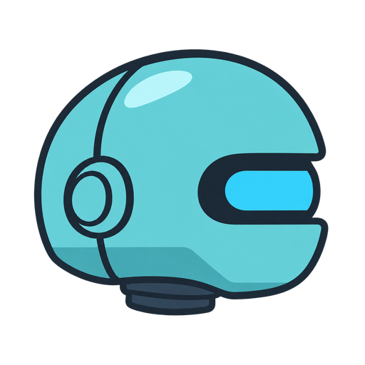

<div align="center">
  
  <h1>robot2D</h1>
  <p><strong>A 2D game engine built in C++, with a visual editor and C# scripting.</strong></p>
  <p>A personal project for learning, experimenting, and making games.</p>
  <p>
    <a href="https://github.com/Enziferum/robot2D/actions/workflows/ci.yml?query=branch%3Adev"></a>
    <a href="https://github.com/Enziferum/robot2D/milestones"></a>
  </p>
  <p>
    <a href="https://enziferum.github.io/robot2D/">Website</a> ·
    <a href="https://enziferum.github.io/robot2D/docs/">Documentation</a> ·
    <a href="#inside-robot2d">Features</a> ·
    <a href="#build-from-source">Build from source</a> ·
    <a href="#road-to-10">Roadmap</a> ·
    <a href="https://github.com/Enziferum/robot2D/issues">Issues</a>
  </p>
</div>

---

robot2D brings a C++ engine core, a scene editor, and C# gameplay scripting
into one project. Compose scenes in the editor, add C# behavior, try it in Play
mode, and run a packaged scene in the standalone player.

**Development preview.** The current line is **0.8.0-dev**. Core systems and editor
tools, a standalone player, and the first Robot Lab demo stage are implemented.
The complete create → play → export workflow and release acceptance are still
in progress. APIs and project formats may change before 1.0.

## Inside robot2D

| Area | What is in the codebase today |
| --- | --- |
| C++ core | Windowing, input, timing, resources, and an entity-component-system implementation. |
| 2D graphics | OpenGL rendering with sprites, text, textures, shaders, views, and batching. |
| Scene editor | Scene viewport, hierarchy, Inspector, asset browser, and transform tools. |
| Gameplay scripting | C# integration through Mono, script instances, and editor/runtime bindings. |
| Animation tools | Sprite-sheet slicing, animation clips, an Animation panel, and playback systems. |
| Physics | Box2D integration with rigid bodies, colliders, collision filters, and C# collision/trigger callbacks. |
| Project resources | Project-relative assets, prefab serialization, and import and packaging groundwork. |
| Standalone player | A separate game executable with a launch manifest and a bundled Mono runtime. |

## Try and learn

- **[Robot Lab](examples/RobotLabPlatformer/README.md)** — the first C# platformer
  stage: movement, jumping across platforms, and recovery after a fall. Follow
  its README to prepare a local project copy and open it in the editor. Cells,
  hazards, checkpoints, and the complete game loop are planned stages.
- **[Core / C++ lessons](https://enziferum.github.io/robot2D/docs/core/)** — build
  your first sprite and add keyboard movement with the engine library.
- **[Your first scene](https://enziferum.github.io/robot2D/docs/first-scene/)** and
  **[C# scripting](https://enziferum.github.io/robot2D/docs/scripting/)** —
  introductory editor and gameplay guides.
- **[Standalone player](#standalone-player)** — launch manifest, build commands,
  packaging, and current limits. The test arena is an infrastructure diagnostic.

These describe existing systems; release acceptance is still in progress.
Undo/Redo, runtime object lifecycle, resource handling, and standalone builds have
[tracked work and acceptance criteria](https://github.com/Enziferum/robot2D/issues).

## Road to 1.0

| Milestone | Goal |
| --- | --- |
| **0.8** | Create, build, and share Robot Lab, a small 2D platformer with animation, C# gameplay, and a standalone player. |
| **0.9** | Develop the architecture, scene transitions, audio, game UI, and editor workflow. |
| **1.0** | Deliver a stable public tool with documented compatibility, project recovery, a reproducible example, and an installer. |

These are planned outcomes; release dates have not been set. See the
[public roadmap](https://enziferum.github.io/robot2D/roadmap/),
[release milestones](https://github.com/Enziferum/robot2D/milestones), and
[development board](https://github.com/users/Enziferum/projects/5).

## Build from source

### Platforms and requirements

Windows and Linux are covered by the build workflow. **macOS is currently
unsupported:** the renderer targets OpenGL 4.5, beyond the system OpenGL 4.1 limit.

You will need:

- A C++17 compiler, CMake 3.21 or newer, and a matching build tool; CI uses Ninja.
- Python 3.8 or newer for the development and CI scripts.
- GLFW, spdlog, FreeType, and OpenGL development libraries.
- Mono development tools and runtime for the editor's C# integration.
- The repository's submodules, including yaml-cpp, Box2D, and RBIni.

The [CI workflow](.github/workflows/ci.yml) records the concrete Windows/MSYS2 and
Ubuntu package setup. Start there for platform-specific dependencies and ensure
CMake can discover them. On Windows, use a shell configured for your compiler
and make Mono discoverable; CI installs it separately.

### Get the sources

```sh
git clone --branch dev --recurse-submodules https://github.com/Enziferum/robot2D.git
cd robot2D
python scripts/install_git_hooks.py
```

If you already have a checkout, initialize its dependencies with
`git submodule update --init --recursive`.
See [AGENTS.md](AGENTS.md) for contributor commands, formatting and required hooks.

### Configure and build

With dependencies installed, use a fresh build directory from a shell with
Ninja and your compiler available:

```sh
cmake -S . -B build -G Ninja -DCMAKE_BUILD_TYPE=Release -DCMAKE_POLICY_VERSION_MINIMUM=3.5
cmake --build build --target robot2D --parallel 4
```

`robot2D` is the editor executable target; `robot2D-core` is the engine library.
The policy setting matches CI and permits the older CMake declarations in
bundled dependencies when using newer CMake versions. Do not reuse a build
directory configured with a different compiler or generator.

### Run the tests

Enable the suites in that same configuration, then build them:

```sh
cmake -S . -B build -DRB2D_BUILD_CORE_TESTS=ON -DRB2D_BUILD_EDITOR_TESTS=ON
cmake --build build --target robot2D-core-tests robot2D-editor-test-suite --parallel 4
ctest --test-dir build -C Release --no-tests=error --output-on-failure
```

Editor tests that need an OpenGL context are opt-in through
`RB2D_EDITOR_GRAPHICS_TESTS=ON`; run headless cases with `ctest --test-dir build -L headless --output-on-failure`
and graphics cases with `ctest --test-dir build -L graphics --output-on-failure`.
Graphics tests need a working display and OpenGL context. Successful compilation
does not replace manual editor and gameplay acceptance. The
[CI script](scripts/ci.py) and [workflow](.github/workflows/ci.yml) provide the
reproducible Windows/Linux build and report commands.

### Standalone player

```sh
cmake --build build --target robot2D-player --parallel 4
```

The target stages `Game.exe` on Windows (`Game` on Linux) under `build/player`,
with runtime dependencies. Copy this template into a separate game directory,
add the project's assets and compiled C# assembly, and create `game-launch.yaml`
beside the executable:

```yaml
Version: 1
Title: My game
StartScene: assets/scenes/main.scene
ScriptAssembly: assets/scripts/bin/MyGame.dll
ScriptCore: runtime/robot2D_ScriptCore.dll
MonoLib: runtime/mono/lib
MonoEtc: runtime/mono/etc
Window:
  Width: 1280
  Height: 720
  Fullscreen: false
```

Paths are relative to the manifest directory. `Game.exe --check` validates the
package inputs without opening a window; `--manifest <path>` selects another
manifest. A complete editor export workflow is still in development.

## Documentation

Start with the **[documentation website](https://enziferum.github.io/robot2D/docs/)**
for getting started, editor/C# guides, and Core lessons. The
[Robot Lab learning path](https://enziferum.github.io/robot2D/docs/learn/)
connects the demo to the systems behind it. These guides are growing alongside
the engine; a stable public API reference remains a goal for 1.0.

Contributor commands and repository conventions are in [AGENTS.md](AGENTS.md).
Public headers, managed API sources and tests describe the implementation;
[Core API reference generation](core/README.md) is available through Doxygen.
Issues and milestones track planned work and release acceptance.

## Repository layout

```text
core/           C++ engine library, core tests, and sandbox
editor/         Scene editor, C# integration, resources, and editor tests
cmake/          Shared build configuration
scripts/        Build, validation, and development tools
examples/       Robot Lab source project and preparation instructions
website/        Public website, guides, Core lesson sources, and branding
```

## Follow the project

robot2D is a personal project by [Enziferum](https://github.com/Enziferum), who
leads its design and development. AI assistance is used for selected UI work,
Git hooks, infrastructure and development support; design decisions and final
review remain with the author.

Follow progress on the [development board](https://github.com/users/Enziferum/projects/5),
browse [issues](https://github.com/Enziferum/robot2D/issues), or report a problem
with steps to reproduce and your platform details.

robot2D is still a place to learn, have fun, and make games. The next step is to
turn that work into a complete first-game experience others can try.
