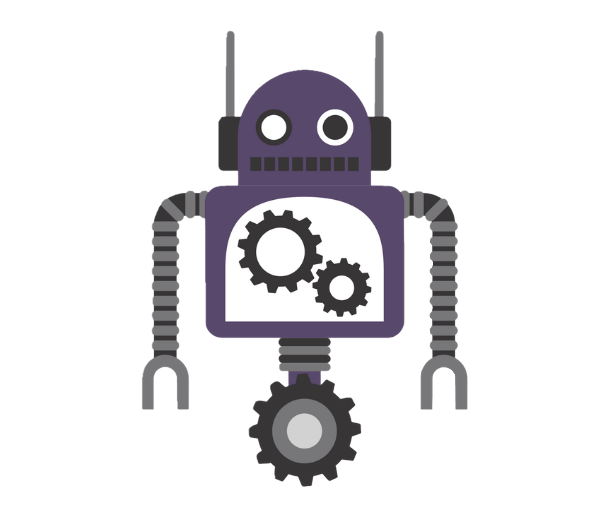

<div align="center">
  
  <h1>robot2D</h1>
  <p><strong>A 2D game engine built in C++, with a visual editor and C# scripting.</strong></p>
  <p>A personal project for learning, experimenting, and making games.</p>
  <p>
    <a href="https://github.com/Enziferum/robot2D/actions/workflows/ci.yml?query=branch%3Adev"></a>
    <a href="docs/release-roadmap.md"></a>
  </p>
  <p>
    <a href="#inside-robot2d">Features</a> ·
    <a href="#build-from-source">Build from source</a> ·
    <a href="#road-to-10">Roadmap</a> ·
    <a href="#documentation">Documentation</a> ·
    <a href="https://github.com/Enziferum/robot2D/issues">Issues</a>
  </p>
</div>

---

robot2D brings a C++ engine core, a scene editor, and C# gameplay scripting
into one project. The direction is an editor-centered workflow: compose a scene,
add behavior, try it in Play mode, and eventually build a game to share.

**Development preview.** The current line is **0.8.0-dev**. Core systems and editor
tools exist, while the complete create → play → standalone build workflow is
still being developed. APIs and project formats may change before 1.0.

## Inside robot2D

| Area | What is in the codebase today |
| --- | --- |
| C++ core | Windowing, input, timing, resources, and an entity-component-system implementation. |
| 2D graphics | OpenGL rendering with sprites, text, textures, shaders, views, and batching. |
| Scene editor | Scene viewport, hierarchy, Inspector, asset browser, and transform tools. |
| Gameplay scripting | C# integration through Mono, script instances, and editor/runtime bindings. |
| Animation tools | Sprite-sheet slicing, animation clips, an Animation panel, and playback systems. |
| Project resources | Project-relative asset references and the first import and packaging groundwork. |

These describe existing systems, not a claim that every workflow is finished.
Undo/Redo, runtime object lifecycle, resource handling, and standalone builds have
[tracked work and acceptance criteria](docs/release-roadmap.md).

## Road to 1.0

| Milestone | Goal |
| --- | --- |
| **0.8** | Create, build, and share a small 2D arena game, with animation, C# gameplay, and a standalone player. |
| **0.9** | Develop the architecture, scene transitions, audio, game UI, and editor workflow. |
| **1.0** | Deliver a stable public tool with documented compatibility, project recovery, a reproducible example, and an installer. |

These are planned outcomes; release dates have not been set. See the
[project roadmap](docs/project-roadmap.md),
[release criteria](docs/release-roadmap.md), and
[development board](https://github.com/users/Enziferum/projects/5).

## Build from source

### Platforms and requirements

Windows and Linux are covered by the build workflow. **macOS is currently
unsupported:** the renderer targets OpenGL 4.5, beyond the system OpenGL 4.1 limit.

You will need:

- A C++17 compiler, CMake 3.21 or newer, and a matching build tool; CI uses Ninja.
- Python 3.8 or newer for the development and CI scripts.
- GLFW, spdlog, FreeType, and OpenGL development libraries.
- Mono development tools and runtime for the editor's C# integration.
- The repository's submodules, including yaml-cpp, Box2D, and RBIni.

The [CI workflow](.github/workflows/ci.yml) records the concrete Windows/MSYS2 and
Ubuntu package setup. Start there for platform-specific dependencies and ensure
CMake can discover them. On Windows, use a shell configured for your compiler
and make Mono discoverable; CI installs it separately.

### Get the sources

```sh
git clone --branch dev --recurse-submodules https://github.com/Enziferum/robot2D.git
cd robot2D
python scripts/install_git_hooks.py
```

If you already have a checkout, initialize its dependencies with
`git submodule update --init --recursive`.
See the [development tools guide](docs/development-tools.md) before making changes.

### Configure and build

With dependencies installed, use a fresh build directory from a shell with
Ninja and your compiler available:

```sh
cmake -S . -B build -G Ninja -DCMAKE_BUILD_TYPE=Release -DCMAKE_POLICY_VERSION_MINIMUM=3.5
cmake --build build --target robot2D --parallel 4
```

`robot2D` is the editor executable target; `robot2D-core` is the engine library.
The policy setting matches CI and permits the older CMake declarations in
bundled dependencies when using newer CMake versions. Do not reuse a build
directory configured with a different compiler or generator.

### Run the tests

Enable the suites in that same configuration, then build them:

```sh
cmake -S . -B build -DRB2D_BUILD_CORE_TESTS=ON -DRB2D_BUILD_EDITOR_TESTS=ON
cmake --build build --target robot2D-core-tests robot2D-editor-test-suite --parallel 4
ctest --test-dir build -C Release --no-tests=error --output-on-failure
```

Editor tests that need an OpenGL context are opt-in through
`RB2D_EDITOR_GRAPHICS_TESTS=ON`. See the
[editor testing guide](docs/editor-testing.md) for headless/graphics runs and
manual UI checks. To reproduce the CI build and reports, follow the
[CI guide](docs/ci.md).

## Documentation

| Start here | What you will find |
| --- | --- |
| [Project roadmap](docs/project-roadmap.md) | Shared direction for Core, ECS, rendering, Editor, and runtime. |
| [Release roadmap](docs/release-roadmap.md) | Goals, dependencies, and acceptance criteria for 0.8–1.0. |
| [Project assets](docs/project-assets.md) | Current asset path, import, and packaging contracts and limitations. |
| [Development tools](docs/development-tools.md) | Formatting, static analysis, and required commit checks. |
| [Editor tests](docs/editor-testing.md) | Automated coverage, configuration, and manual scenarios. |
| [CI and reports](docs/ci.md) | Windows/Linux builds, test reports, and local reproduction. |
| [Project workflow](docs/project-workflow.md) | Task IDs, branches, contribution workflow, and Git hooks. |
| [Versioning](docs/versioning.md) | Development, release-candidate, and stable version rules. |

These are development documents. A beginner tutorial and a stable public C# API
reference are part of the road to 1.0.

## Repository layout

```text
core/           C++ engine library, core tests, and sandbox
editor/         Scene editor, C# integration, resources, and editor tests
cmake/          Shared build configuration
scripts/        Build, validation, and development tools
docs/           Design notes, workflow, and release plans
```

## Follow the project

Follow progress on the [development board](https://github.com/users/Enziferum/projects/5),
browse [issues](https://github.com/Enziferum/robot2D/issues), or report a problem
with steps to reproduce and your platform details.

robot2D is still a place to learn, have fun, and make games. The next step is to
turn that work into a complete first-game experience others can try.
