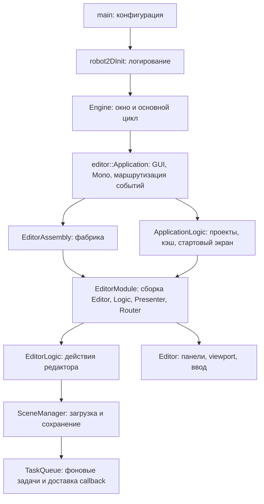

# Запуск, диагностика и границы ответственности

Разбор 2026-10-15 по актуальному коду. Предложения по разделению классов ниже
не означают согласованную переработку архитектуры.

## Текущий путь выполнения

`main` остаётся небольшим, а `Engine` отвечает за окно и цикл. Это разумная
основа. Само наличие объекта, собирающего зависимости, не делает его God Object:
важно, содержит ли он реализацию независимых сценариев и их состояние.

## Что требует внимания

### Порядок инициализации и завершения

В первоначальном разборе ApplicationLogic::setup вызывался до EditorModule::setup:
автооткрытие проекта могло начать загрузку до создания ScriptInteractor. В ASYNC-01
порядок исправлен: сначала модуль редактора и его зависимости, затем логика старта.

Также исправлено штатное завершение: сначала остановка TaskQueue и runtime,
освобождение EditorModule, затем остановка file watcher и завершение Mono.
Engine освобождает Application при ещё живом локальном окне. Контракт и ограничения —
в [завершении фоновых задач](task-queue-lifecycle.md).

В `Engine::run()` destroy вызывается только после нормального выхода из цикла.
При исключении из setup/update/render управление пока уходит в constructEngine,
минуя этот вызов. Аварийное освобождение при частичной инициализации, а также
владение глобальными графическими кэшами ещё нужно проработать через RAII.

### EditorLogic — основной кандидат на разделение

В одном классе реализованы загрузка и сохранение, подтверждение закрытия,
выделение и пространственный поиск, clipboard и команды, prefab, runtime,
экспорт и запуск генератора C#-проекта через std::async/std::system.
Это независимые причины изменения класса, а не только большое число строк.

Предлагаемые границы, выделяемые по одной при работе над соответствующим сценарием:

- **Сессия редактора:** текущие проект/сцена, открытие, сохранение, закрытие,
  актуальность загрузки. Сначала определить одного владельца смены активной сцены:
  сейчас её shared_ptr есть у SceneManager, EditorLogic и Editor.
- **Действия над сущностями:** clipboard, duplicate/delete/paste и CommandStack;
  взаимодействие со Snapshot согласовать с пользователем.
- **Runtime:** запуск/остановка игры, взаимодействие со scripting.
- **Сборка и экспорт проекта:** генерация C#-проекта и export с явным результатом.

EditorLogic может остаться координатором этих сценариев с узкими интерфейсами.
Не нужно переносить все его поля в один новый EditorServices: это сохранит связность.

### Editor — второй кандидат

Класс одновременно собирает панели, управляет двумя framebuffer, камерой и gizmo,
обрабатывает ввод/shortcuts и владеет PrefabManager с сохранением ресурсов.
Направления разделения: viewport/rendering, ввод и команды, сборка панелей;
владение редактируемыми prefab стоит рассматривать на уровне сессии/ресурсов.
UI может вызывать операцию сохранения через интерфейс, не определяя её правила.

### Остальные участники

- Application сейчас главным образом координирует подсистемы; приоритет — порядок
  их жизни, а не механическое дробление setup на классы.
- EditorModule — подходящее место сборки зависимостей редактора. EditorAssembly
  сейчас только создаёт EditorModule, а renderWindow в фабрике не используется;
  дополнительную ценность этого слоя стоит оценить перед его расширением.
- Presenter в основном делегирует вызовы Editor, Router::openScene всегда
  возвращает true. Эти слои пока не дают независимой обработки переходов/ошибок.
  Стоит определить их назначение, прежде чем наращивать промежуточные интерфейсы.
- У MessageDispatcher нет отписки, callbacks захватывают this. При будущей
  пересборке модулей нужно определить время жизни подписок.
- Singleton TaskQueue скрывает владение и глобальный shutdown за EditorLogic.
  Механика остановки и доставки результатов реализована в ASYNC-01; CancellationToken
  делает пользователь. Место владения очередью при разделении сессии ещё обсуждается.

## Interactors: предложение для обсуждения

Сейчас EditorLogic реализует EditorInteractor, который наследует UIInteractor.
UIInteractor одновременно открывает доступ к выделению, сущностям, командам,
prefab, export и scripting. Поэтому любая панель с этим интерфейсом может зависеть
от почти всего редактора. Само выделение методов в интерфейс эту связность не снимает.

ScriptInteractor тоже выполняет две роли: адаптер вызовов из скриптов к редактору
и интерфейс метаданных/вызовов scripting для сериализации и Inspector. При этом
первая роль держит weak_ptr на весь EditorInteractor, хотя для поиска сущностей
и runtime-операций достаточно более узкого доступа. Ряд runtime-методов пока
пустой; до реализации стоит определить их место, не расширяя общий интерфейс.

Предлагаемые границы зависимостей (названия предварительные):

| Потребитель | Доступ, который ему действительно нужен |
|---|---|
| Иерархия/Inspector | Чтение текущей сцены, SelectionService, согласованные операции изменения сущностей |
| Viewport и shortcuts | Выделение, действия над сущностями, команды управления runtime |
| Меню проекта | Открытие/сохранение/закрытие сессии, отдельный сервис сборки/экспорта |
| Сериализатор и Inspector scripting | Метаданные классов и полей; без доступа к окну, панели и общему EditorLogic |
| Скрипты во время игры | Поиск runtime-сущностей и runtime-команды; без editor clipboard, popup и export |

Первый кандидат на конкретное выделение — сессия проекта/сцены: один владелец
переходов и активной сцены, явное состояние загрузки, результат операции.
EditorLogic на первом шаге может делегировать ей вызовы, сохраняя существующие
интерфейсы для остальных панелей. Следующим отдельным шагом сужаем интерфейсы
потребителей, а не делаем одновременную замену всех Interactors.

Состояние Edit/Run/Load сейчас находится в EditorPresenter, хотя определяет
доступность операций приложения. При выделении сессии логическое состояние
должно иметь одного владельца в сессии/runtime; Presenter только отображает его.
Для Presenter и Router нужно отдельно решить, есть ли у каждого самостоятельная
роль: сейчас Router::openScene — тонкое делегирование, а Presenter также вызывает
сохранение ресурсов через view. Не стоит добавлять новый слой ради соответствия
названию архитектурного шаблона.

Это предложения, а не выполненный рефакторинг. Сначала согласовать владельца
сессии, различие editor/runtime-сцены и нужные панели-потребители; затем выбрать
один сценарий миграции. Snapshot и CancellationToken остаются за пользователем.

## Диагностические события

Событие на границе операции должно отвечать: что началось, с каким путём/ID,
на какой стадии завершилось и почему произошла ошибка. INFO — редкие операции
и переходы, TRACE — подробные шаги для диагностики, WARN — восстановимая проблема,
ERROR — операция не выполнена. Не писать INFO каждый кадр или для каждого движения мыши.

В этом шаге добавлены события Engine/Application, постановки загрузки,
десериализации и CPU-загрузки ресурсов, применения сцены и сохранения.
Файл содержит дату, миллисекунды, уровень и ID потока. Успешное завершение CPU-части
не означает, что все внешние ресурсы доступны: существующие предупреждения
об отсутствующих ресурсах остаются отдельными событиями.

Первый шаг логирования не исправлял найденные дефекты. В последующем ASYNC-01
исправлены публикация ошибочной загрузки и штатный порядок setup/shutdown.
Файл robot2D.log пока перезаписывается при запуске; ротация и сохранение предыдущей
сессии остаются следующим улучшением диагностики.

## Порядок следующих изменений

Пользователь разрешил реализацию очереди и штатного порядка жизни подсистем.
Общий ориентир (часть аварийного cleanup ещё впереди):

1. Логирование → окно/OpenGL → GUI и конфигурация → Mono.
2. Создание EditorModule → его setup (ScriptInteractor, EditorLogic и панели).
3. Setup ApplicationLogic: подписки, кэш, выбор стартового экрана, только затем
   запрос открытия последнего проекта. Начало загрузки требует готового interactor.
4. После подтверждения закрытия запретить новые фоновые запросы и применение
   запоздалых результатов, дождаться активной работы; затем завершить runtime,
   чтобы он не освобождал scripting-данные одновременно с работающей задачей.
5. Освободить очереди результатов, сцены и связанные scripting-объекты при ещё
   работающем Mono; затем завершить Mono.
6. Освободить GUI и графические ресурсы при живом OpenGL-контексте; окно — последним.

Перестановка setup исправляет стартовую зависимость. Для shutdown помимо перестановки
реализовано освобождение результатов очереди и модуля редактора; глобальные кэши
и аварийный путь требуют дальнейшего разбора.
При исключениях в середине setup нужен учёт уже созданных ресурсов и тот же
безопасный порядок освобождения; вызывать полный destroy у недостроенного
приложения без проверки готовности нельзя.

Сначала проверить логи на реальном запуске/открытии/сохранении/закрытии и разобрать
начальные предупреждения анализатора. Затем согласовать порядок setup/shutdown
и владельца сессии. Разделять EditorLogic и Editor по сценариям, подкрепляя
каждый перенос проверкой поведения, а не переписывать всю архитектуру за один шаг.
