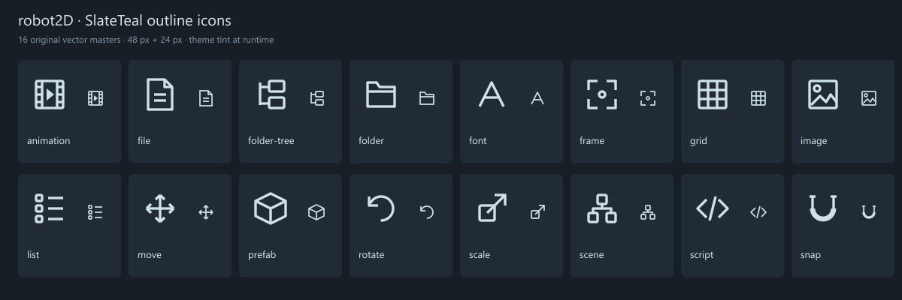

# ASSET-01: AssetsPanel, preview и векторные иконки

Первый согласованный шаг [ASSET-01 #47](https://github.com/Enziferum/robot2D/issues/47).
Общий маршрут — [project-roadmap.md](project-roadmap.md). Ассистент ведёт реализацию
по поручению пользователя 2026-10-16 в отдельном worktree `asset-01`, ветка ASSET-01
от dev df823bb. Основной checkout не переключается и не редактируется.

## Навигация

- Слева дерево только папок, справа breadcrumbs и файлы. В верхней строке
  доступны векторные кнопки Folder tree, Tile view и List view с tooltip
  и подсветкой выбранного режима. Дерево можно скрыть, список показывает
  компактные строки с миниатюрой, именем и типом; операции над файлами общие.
  При открытии дерева его исходная ширина не больше 35% панели.
  Режим вида/видимость дерева действуют в текущем сеансе редактора. Граница колонок
  изменяется мышью и участвует в обычных настройках ImGui tables.
- Tree, Up, breadcrumbs и double-click карточки используют общий текущий путь.
  Переход раскрывает предков выбранной папки. Папки сортируются перед файлами.
- Дерево загружает только открытые ветки, максимум 32 уровня; глубже можно
  переходить карточками. Символьные ссылки не разворачиваются в дереве;
  навигация и preview не выходят за канонический корень assets.
- Снимки каталогов кэшируются на 1 секунду, максимум 128 каталогов. Refresh
  перечитывает папки и preview. При удалении текущей папки выбирается ближайший
  существующий родитель внутри assets. Недоступная папка показывает сообщение.
- Существующие импорт, rename/delete и drag/drop сохраняются. Этот шаг не
  гарантирует перенос ссылок потребителей при rename/delete: это остаётся
  критерием полного ASSET-01. Перенос файлов через дерево не добавлялся.

## Preview

- PNG/JPEG/BMP/TGA используют core Image decoder. Загружаются только видимые
  карточки, не более двух новых задач за кадр, до четырёх незавершённых задач.
- Декодирование и alpha-aware box downsampling выполняются TaskQueue worker.
  Размер результата не превышает 128×128, пропорции сохраняются; серые/RGB/RGBA
  каналы приводятся к RGBA. RGB усредняется с весом alpha, затем хранится как
  straight alpha, чтобы прозрачные края не темнели.
- GL texture создаётся только при запросе изображения из UI, до двух uploads
  за кадр. Worker и completion callback не выполняют OpenGL-операции.
- Кэш содержит до 64 записей, включая ошибки и ожидание. Записи, нарисованные
  в текущем кадре, не вытесняются. Устаревшая текстура после invalidate/refresh
  остаётся жива до следующего кадра, чтобы не сломать уже записанный ImGui draw.
- Ключ — канонический путь; изменение mtime/размера проверяется не чаще раза
  в секунду. Ошибка остаётся placeholder-иконкой с причиной в tooltip; повтор
  после изменения файла либо Refresh. PNG alpha показана на шахматной подложке.
- При смене корня или уничтожении панели callbacks используют слабые ссылки;
  результаты старого поколения не публикуются в новом. Отброшенные TaskQueue
  задачи не удерживают навсегда лимит запросов. Очередь остаётся общей с движком.
- Файлы больше 16 MiB не декодируются. Размеры больше 8192 по стороне
  отклоняются после декодирования. Лимит исходной памяти внутри core decoder
  этим UI-шагом не задаётся; лимиты кэша относятся к уменьшенным результатам.
  Content hash, watchers, disk cache и приоритетная очередь не добавлялись.

Текстуры принадлежат панели и освобождаются при уничтожении EditorModule,
пока OpenGL-контекст ещё существует. API cache/GL upload рассчитан на UI-поток;
сохранение указателя на запись через beginFrame/eviction не поддерживается.

## Иконки

16 оригинальных outline-иконок в [EditorIcons.cpp](../editor/src/EditorIcons.cpp)
используют сетку 24 единицы и один stroke 1.7. В runtime рисуются напрямую
ImDrawList и окрашиваются темой; bitmap и шрифт для них не нужны.
SVG-мастера — [editor/res/icons/outline](../editor/res/icons/outline).
По запросу пользователя VIEW-01 @107c3be объединена в ASSET-01 / PR #127:
Toolbar, SlateTeal, Assets и Preview поставляются одной веткой. PR #124
заменяется общим PR без merge в dev. Добавлены List и FolderTree; отступ
имени в дереве вычисляется по ширине иконки вместо пробелов.

[SVG-доска](media/editor-icons.svg). PNG 24/48 px подготовлены отдельно
для выдачи; белые glyphs с alpha подходят для tint. Маленькие UI-иконки
построены векторно, генератор растровых изображений не использовался.

## Проверки и ручная приёмка

Постоянные headless: navigation, decode, cache, icons, panel. Проверяются
границы assets, пропорции/alpha PNG/JPEG/TGA, повреждённое/слишком большое
изображение, совпадающие имена, mtime-инвалидация, LRU и смена поколения,
границы рисунка и реальный ImGui layout на ширине 900/360/180 px.
Graphics-сценарий asset-preview проверяет создание GL texture и отложенное
удаление при invalidate. Все включены в существующий editor-test-suite.

Выполнено: сборка редактора/core-tests/editor-suite; полный CTest ASSET-01
109/109 до последней защиты деления на ноль, затем targeted decode и hook:
Python 47/47, headless 67/67, формат, строгий clang-tidy 183 единиц.
Финальные native-исходники вместе с VIEW-01 107c3be собраны отдельно:
112/112 CTest, включая 42 graphics, без пропусков. Это локальная интеграционная
сборка, оба PR остаются независимыми и не слиты. ASSET-01: 32e90e5.
Ручная UI-приёмка ещё не выполнена; тест layout не доказывает визуальное
качество на конкретном DPI и не заменяет пользовательский сценарий ниже.

1. Открыть проект с PNG с alpha, JPEG, широкой платформой и высоким персонажем.
   Проверить пропорции/фон и resize Preview от 48 до 128.
2. Переходить дерево → breadcrumbs → карточки и Up, проверить выделение,
   раскрытие родителей и изменение ширины двух областей.
3. Прокрутить большую папку, быстро сменить папку/проект во время загрузки.
   Старые изображения не должны появляться в новых карточках.
4. Заменить файл на диске, подождать секунду или нажать Refresh; проверить
   новую миниатюру, одинаковые имена в разных папках и повреждённый PNG.
5. Удалить текущую папку снаружи, проверить возврат к родителю; проверить
   пустую/недоступную папку и глубокое дерево.
6. Переключить плитку/список, скрыть/показать дерево. Проверить выбранную
   подсветку и tooltip, карточки/строки и rename в обоих видах; дерево на узкой
   панели не должно перекрывать имена папок.
7. Проверить прежние импорт, rename, создание папки/сцены и drag/drop ресурсов
   без объявления неготовой миграции ссылок; закрыть редактор во время preview.

Следующий шаг — ревью PR, ручная приёмка и отдельное согласование остального
asset lifecycle. Issue #47 не закрывается автоматически этим UI-шагом.

Проверки объединённого шага @a0d316f: обязательный hook Python 47/47,
headless CTest 70/70, формат и строгий clang-tidy 183 единиц прошли.
Затем редактор/core-tests/editor-suite собраны с graphics; полный CTest
112/112 без пропусков, включая 42 graphics. ImGui-тест проверяет реальные
клики переключателей; ручная визуальная приёмка на пользовательском DPI открыта.
Локальный launcher work/run-ui-preview.cmd теперь запускает сборку непосредственно
из ASSET-01 work/pre-commit-build, прежний экспорт исходников больше не требуется.

## ASSET-01: интеграция исправления RUNTIME-02 — 2026-10-16

По запросу пользователя RUNTIME-02 @8cffb9e объединена в ASSET-01 вместе
с dev ab0f3a5. Сохранены SlateTeal, Toolbar, preview/дерево/варианты вида Assets,
а также новый SCRIPT-01/HUD-01 и исправление runtime UISystem. Конфликты
разрешены с сохранением всех тестов. Пользователь подтвердил работоспособность
отдельного RUNTIME-02; приёмка общей сборки с новым UI остаётся пользователю.
Computer-use не использовался и запрещён правилами проекта.

Проверки общей сборки: editor/core-tests/editor-suite собраны; полный CTest
119/119 без пропусков, включая 44 graphics. Прежний launcher
work/run-ui-preview.cmd запускает актуальный ASSET-01/work/pre-commit-build/editor/robot2D.exe.
Следующий шаг — обязательный hook, обновление PR #127 и ручная проверка демо.

Интеграция опубликована merge-коммитом 30c7580 (RUNTIME-02 8cffb9e является
предком ASSET-01). Обязательный hook прошёл: Python 53/53, headless 75/75,
формат и строгий clang-tidy 186 единиц. Первый hook дал Windows rename failure
в asset-paths; пять повторов этого теста и следующий полный hook прошли.
Полная общая проверка с graphics: 119/119 (44 graphics), без пропусков.
Далее — пользовательская приёмка RobotLabPlatformer с новым UI.
