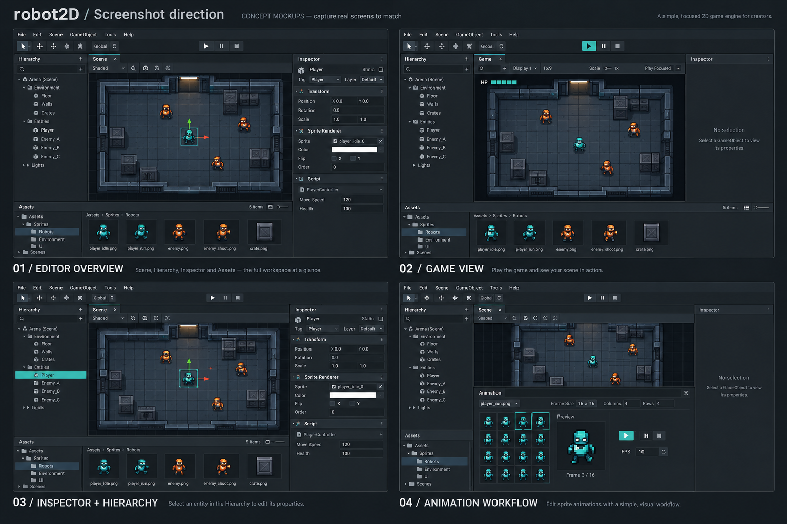

# WEB-01: публичное оформление robot2D

Задача: [WEB-01 #108](https://github.com/Enziferum/robot2D/issues/108).
Это материалы направления из [общего плана](project-roadmap.md), а не отдельный
релизный roadmap. Реализация поручена ассистенту пользователем 2026-10-16.

## Первый шаг

README на английском описывает C++-ядро, визуальный редактор и C# через Mono.
Существующие подсистемы отделены от незавершённого полного игрового цикла.
Версия и цели сверены с CMake и release-roadmap; команды — с CMake и CI.
Сохранён характер личного проекта: обучение, эксперименты и создание игр.

Текущий логотип сохраняется до отдельного согласования нового. В README пока
нет галереи: её добавляем после получения настоящих скриншотов.

## Какие кадры подготовить

Для первой версии достаточно общего вида редактора и Game View. Остальные
кадры добавляются, когда есть что показать. Используем одну реальную сцену,
по возможности с узнаваемым персонажем, несколькими объектами и окружением.
Арена из релизного плана — пример композиции, её готовность не предполагается.

| Файл | Что показать | Композиция |
| --- | --- | --- |
| `editor-overview.png` | Общий вид редактора с наполненной сценой | Viewport занимает около 60% ширины; видны Hierarchy, Inspector и Assets. |
| `game-view.png` | Эту же сцену в Play | Игра крупно, курсор вне действия; без сетки и рамок выделения внутри Game View. |
| `inspector.png` | Выделенный объект сцены и его свойства | Объект виден во viewport, соответствующая строка в Hierarchy и реальные поля Inspector читаемы. |
| `animation.png` | Реально работающий сценарий анимации | Спрайтшит и preview крупно; только существующие элементы панели. Не добавлять неготовые возможности ради кадра. |

- PNG в исходном разрешении, желательно 1920×1080 или выше, если это удобно.
- Одинаковая тема, масштаб интерфейса и сцена во всех кадрах.
- Не растягивать изображение и не дорисовывать элементы интерфейса или игры.
- Закрыть диалоги и подсказки; убрать личные пути и несвязанные окна.
- Использовать свои ассеты либо материалы с разрешённой публикацией; сохранить авторство и ссылку на источник, если нужно.
- Входящие кадры можно положить в `work/website-screenshots/` основной рабочей
  копии и сообщить путь. Отобранные копии попадут в `docs/media/screenshots/`
  ветки WEB-01; добавлять их в ECS-ветку не нужно.
- Для каждого кадра записать ветку/commit, сцену и краткое описание показанного.

## Визуальный ориентир

Это сгенерированная доска композиций, **не скриншоты robot2D и не образец
точного интерфейса**. Условные арена, HUD, названия компонентов и расположение
панелей не доказывают наличие функций. Повторять нужно идею кадра, а реальные
панели и состояние движка сохранять. В публичную галерею эта доска не идёт.
Источник: встроенный imagegen; полный запрос —
[screenshot-direction-prompt.txt](media/concepts/screenshot-direction-prompt.txt).

## Основа будущего сайта

Предложение структуры для обсуждения, без реализации и публикации:

- Главная: краткое описание, настоящий кадр редактора, статус development preview.
- Features: конкретные возможности с примерами; незавершённое связывать с roadmap.
- Showcase: реальные сцены/игры с указанием, что можно скачать или запустить.
- Docs: начало работы, первая сцена, C#; сначала допускаются ссылки на имеющиеся документы.
- Downloads / Releases: только фактически опубликованные сборки, платформы,
  требования и changelog; установщик не обещать до DIST-01.
- Roadmap: краткое представление общего релизного маршрута со ссылками на Issues.

Astro + Starlight — обсуждавшийся вариант. Выбор стека, хостинг, домен,
автопубликация и donations требуют отдельного решения по соответствующему шагу.
Тёмная/бирюзовая палитра — направление оформления, а не запрос менять тему редактора.

## Проверки и следующий шаг

2026-10-16: первый шаг затрагивает только документацию, реестр задачи и
концептуальный материал. Проверяются diff, локальные ссылки, JSON и соответствие
команд существующим целям CMake. Нативная сборка не требуется и не запускалась;
свежую проверку команд на чистом окружении этот шаг не заменяет.

Следующий шаг — получить настоящие кадры, выбрать главный и добавить галерею
в README. Затем согласовать первый макет сайта и объём его реализации.
WEB-01 остаётся открытой до приёмки визуальных материалов.
