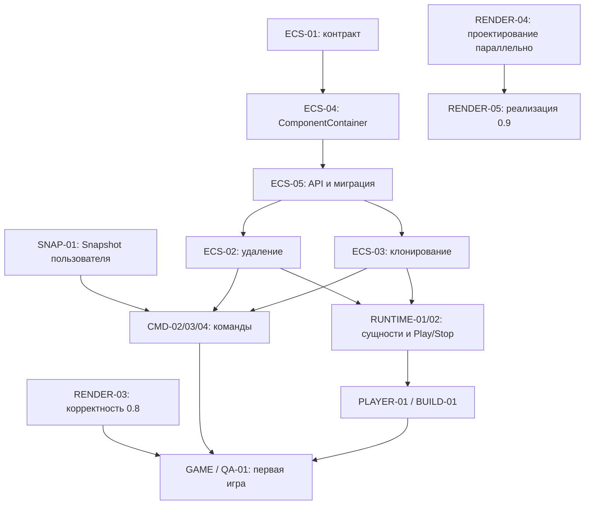

# Общий план robot2D

Обновлено: 2026-10-17. Это точка входа для всех направлений и чатов проекта:
Core, ECS, Render, Editor, runtime/player, пример игры и инструменты выпуска.
Релизные критерии — [release-roadmap.md](release-roadmap.md). Оперативные статусы,
выбранные ведущие и результаты находятся в GitHub Issues и
[Projects](https://github.com/users/Enziferum/projects/5).

## Актуальный план Core и robot2D-imgui — 2026-10-17

По запросу пользователя CORE-01 и CORE-02 объединены в ветке CORE-02 и
[PR #122](https://github.com/Enziferum/robot2D/pull/122). Изменения
[PR #112](https://github.com/Enziferum/robot2D/pull/112) сохраняются вместе с историей;
он заменён объединённым PR. CORE-02 #122 и затем IMGUI-02 #130 слиты в dev
после зелёного CI и подтверждённой пользователем ручной приёмки.
CORE-01 #110 остаётся общей открытой задачей, не обещанием полного завершения Core.
Датированные разделы ниже — история; этот блок задаёт текущие границы плана.

| Этап | Что сделано / что остаётся | Статус |
|---|---|---|
| CORE-01: согласованный Util и базовые классы | ResourceHandler, MessageBus/типизированная память, Logger/Assert, FileInputStream, Time/Clock, совместимые constexpr/noexcept Vector2/3, регрессии, Doxygen | В dev через CORE-02 #122; общий CORE-01 остаётся открыт |
| CORE-02: события | variant Event, typed EventBinder, GLFW FIFO/frame batch, Add*Event, capture/владельцы Press–Release/cancel, история/Events, потребители, UI clicks/shortcuts, startup crash fix | В dev через #122; CI и ручная приёмка пройдены |
| robot2D-imgui: scopes | Безопасные оконные/style scopes и сохранение dockspace при скрытом canvas | Отдельные IMGUI-01 #121 / PR #123; реализованы в соседней ветке, не входят автоматически в CORE-02 |
| robot2D-imgui: текущая корректность renderer | OrthoView Y; GL state и active texture/sampler/program/VAO; UserCallback/reset; scissor clamp/empty; GPU-resource RAII/отказ setup; владение memory-font | IMGUI-02 #126 / PR #130 merged; проверки и ограничения — [gui-backend.md](gui-backend.md) |
| robot2D-imgui: GuiImpl lifecycle | Собственный ImGuiContext, safe shutdown до setup/после отказа, ready только после успеха; состояния кадра, шрифтовый набор | IMGUI-02 #126 / PR #130 merged; lifecycle/font set и G1/input приняты пользователем |
| robot2D-imgui: обёртки | Typed/size-aware drag/drop и borrowed lifetime; явные ImageButton ID, null framebuffer, sprite UV/zero-size, string InputText, Sugar flags/namespace | A7 обсуждается соседним GUI-чатом без реализации; A2–A6 остаются отдельными согласуемыми шагами; A1 — PR #123 |
| Core Window/Desktop | Владение native window/GLFW, уничтожение, ошибки создания; logical/framebuffer size, minimized/DPI, источник событий WindowID, signed coordinates, clipboard/IME и contexts | CORE-01: первый шаг lifetime/runtime/polling реализован локально, проверки/PR; размеры из IMGUI-02 сохранены; остальные пункты отдельно |
| Core Graphics для GUI | Явный UI pass/state/cache; точный vertex layout, draw ranges/baseVertex; streaming buffers, texture views/updates/row pitch, context-local VAO/FBO и lifetime | Связано с RENDER-04 #98 / RENDER-05 #99; согласовать минимальный API до переноса GuiRender |
| Engine / fixed timestep | Общий scheduler editor/player, fixedDt, предел догоняющих шагов, queued Play/Pause/Stop, SessionId | [Контракт согласован](fixed-timestep-contract.md), реализация не начата; сначала завершение CORE-01/02 |
| Runtime / fixed input | Общая RuntimeSession, OnUpdate/OnFixedUpdate, frame/fixed input и временные границы, Pause/Resume | Последующая интеграция RUNTIME-01/02, INPUT-01 и PHYS-01; не реализовано этим объединением |
| GUI upstream и несколько окон | Закреплённый docking upstream, texture lifecycle, VtxOffset/большие списки; затем multi-viewports и несколько monitors | После необходимой корректности и Core API; текущая однооконная поддержка не равна готовой multi-window |
| Диагностика и документация | Crash report; расширение Doxygen Event/Window/Engine и дальнейших публичных API | Требование reporter записано в development-tools.md; справочник ещё не покрывает весь Core |

Подробный аудит и согласованные границы Gui/GuiRender опубликованы в
[документе IMGUI-01](https://github.com/Enziferum/robot2D/blob/f4fc9c3b7fd290a1bf240d722972bc4ced877792/docs/imgui-backend-review.md).
Наблюдения аудита требуют воспроизводящих проверок: таблица не объявляет все
дефекты уже воспроизведёнными и не запускает их реализацию. Изменения соседней
GUI-ветки и пользовательский основной checkout не копируются и не редактируются.

Последовательность сейчас: CORE-02 #122 и IMGUI-02 #130 уже в dev →
согласованный первый шаг Window/Desktop в CORE-01 → проверки/PR/ручная приёмка.
Следующий Graphics API и обновление upstream согласуются отдельно. Тайминг согласован, но
автоматически не запускается; остальные зависимости остаются в своих Issues.
Оптимизацию uploads/ёмкости и VAO выполняем после измерений, отдельным шагом.

Это не полный аудит всех классов Core: например Cursor/Joystick/Mouse/Keyboard,
общий WindowContext и отдельные allocator API не объявляются целиком проверенными
по сборке выбранных изменений. ECS, Snapshot и CancellationToken остаются за
пользователем; вмешательство в них не входит в этот план.

## Где находится информация

| Информация | Источник |
|---|---|
| Общие направления, зависимости и синхронизация чатов | Этот документ |
| Цели 0.8.0 / 0.9.0 / 1.0.0 и реестр релизных задач | [release-roadmap.md](release-roadmap.md) |
| ID и номер Issue; определения меток | [.github/tasks.json](../.github/tasks.json), [.github/task-labels.json](../.github/task-labels.json) |
| Текущий Status, ведущий, границы шага, PR и приёмка | Соответствующая Issue и Projects |
| История работы над редактором и прежних проверок | [editor-roadmap.md](editor-roadmap.md) |
| Нумерация, ветки, коммиты и выбор ведущего | [project-workflow.md](project-workflow.md) |

Не заводить отдельный конкурирующий roadmap для нового чата. Новый объём
сначала связывается с этим планом и зарегистрированным Issue. Milestone задаёт
целевой релиз результата; работа и проектирование могут идти раньше и параллельно.
Новая задача или статус Ready сами по себе не разрешают рефакторинг всего направления.

## Общая база и ветки

Основная интеграционная ветка — `dev`. `october2026_dev` слита в неё через
PR #43 (e54408f); новые задачи идут от актуального dev в ветки `TASK-ID` (например `ASSET-02`,
без префикса `codex/`, по уточнению пользователя 2026-10-16)
и возвращаются в dev через PR. Ближе к стабилизации от dev создаётся
`release/0.8.0`, выпуск фиксируется тегом `v0.8.0`; исправления возвращаются в dev.
Большой несовместимый объём 0.9 интегрируется после отделения релиза 0.8 либо
отдельными согласованными совместимыми шагами. Правила —
[project-workflow.md](project-workflow.md), версия — [versioning.md](versioning.md).

## HUD-01: C# текст и порядок надписей — 2026-10-16

Ведущий — ассистент по поручению пользователя. Ветка HUD-01 в отдельном worktree
от dev df823bb. Добавлен TextComponent.Text/TrySetText; отдельные GPU batches
для надписей, безопасные отсутствующие шрифты и владение текстурой при копии.
Пример Health/Wave/Game Over/reset компилируется и проверяется через Mono.
Редактор и suite собраны; полный CTest 105/105 (42 graphics). Контракт и ручная
приёмка — [hud.md](hud.md). Следующий шаг — CI/review и приёмка Inspector/Play;
полный restart мира остаётся RUNTIME-01, standalone — PLAYER-01/BUILD-01.

## PHYS-01: физика и C# события, 2026-10-16

После merge PR #118 создан отдельный worktree `phys-01`, ветка `PHYS-01`
от актуального `dev` @ `c05a55b`; основной checkout пользователя не переключался.
Реализованы стабильные Enter/Stay/Exit, фильтры, геометрия BoxCollider,
безопасные очереди добавления/удаления тел, очистка Stop и доставка одному
C# получателю с отдельным экземпляром скрипта на сущность.
Контракт, учебный вводный материал и пять практических опытов — [physics.md](physics.md).
Документ расширяется вместе с физическим API; текущий fixed accumulator Engine
отделён от согласованного, но ещё не реализованного OnFixedUpdate.
Ссылка на единый контракт тайминга Core добавлена после сверки 2026-10-16.
В PR #120 добавлена сквозная C# регрессия полного trigger-цикла и согласован enum.
Пройдены 103 CTest, включая 10 новых physics и 41 graphics; собран редактор.
PR #120 остаётся отдельным шагом исправлений. После завершения CORE-02 #119
и его приёмки — интеграция PHYS-01 в единый fixed tick Engine/RuntimeSession
совместно с RUNTIME-01 #77 и INPUT-01 #79: один OnFixedUpdate/Step на tick,
контакты после каждого Step, регрессии 0/N ticks, паузы и безопасных переходов.
План и checklist зафиксированы в Issue #78; scheduler в PR #120 не добавляется.
Полное C# Instantiate/Destroy этим шагом не реализовано; #78 остаётся открытой.

## BUILD-01: подготовка конвейера — 2026-10-16

Поручено ассистенту после SCRIPT-01/HUD-01. Отдельный worktree build-01, ветка
BUILD-01 от dev df823bb. Заглушка ExportTask больше не завершает пустой экспорт
успехом; владеет копией ExportOptions, возвращает ошибку с диагностикой в Console.
Постоянная регрессия очереди проверяет причины и сохранение output.
Редактор и suite собраны, полный CTest 103/103 (41 graphics).
[build-pipeline.md](build-pipeline.md) фиксирует текущие границы, предлагаемые
staging/layout/manifest, стыки со SCRIPT-01 PR #125 и PLAYER-01 и матрицу приёмки.
Следующий шаг — интеграция общего C# сборщика после merge и consumer-контракт player.
Game.exe, переносимый Mono bundle и готовая поставка этим шагом не реализованы.

## Направления проекта

| Направление | 0.8.0 | 0.9.0 | 1.0.0 |
|---|---|---|---|
| Core / ECS | Контракты и необходимые изменения удаления, клонирования, ComponentContainer и API для команд/runtime | Следующие изменения только по отдельно согласованной потребности | Стабильность поддерживаемого API и проверенные миграции |
| Core / Render | Опубликованные RENDER-01/02; RENDER-03 — корректность порядка, камеры и resize для игры | RENDER-04 — контракт; RENDER-05 — основная реализация нового 2D-рендера | Надёжность поддерживаемых сценариев и поставки |
| Editor | Команды/Undo, сохранение, минимальные ресурсы, prefab, анимация | Разделение ответственности, удобство UI/viewport, развитие анимационных инструментов | Восстановление, документация и качество основного цикла |
| Runtime / Player | C#, создание/удаление объектов, физика, ввод, Play/Stop, ранний standalone и Build | Переходы сцен, звук и игровые UI-компоненты | Совместимость, полный цикл и проверенная поставка |
| Пример игры | Играбельная арена и её сборка без dev-окружения | Расширение примера для проверки новых возможностей | Воспроизводимый пример и инструкция для нового пользователя |
| Инструменты | Действующие hooks/CI/версии и воспроизводимый Build | Проверки вместе с изменением поведения | Installer, GitHub Release, проверка новой версии и RC |

3D сохраняется в существующем рабочем объёме. Новый 3D renderer пока не имеет
согласованных объёма и версии; он не включается автоматически в RENDER-05.

## Core / ECS: замысел пользователя

Пользователь назвал четыре направления: удаление, клонирование, API и
ComponentContainer. На этом этапе оформлены задачи и зависимости; новый backend
хранения, archetypes/sparse-set, queries и многопоточность не выбраны и не обещаны.

| Задача | Результат | Цель |
|---|---|---|
| [ECS-01 #100](https://github.com/Enziferum/robot2D/issues/100) | Согласовать контракты, объём и первый шаг | 0.8.0, можно начинать обсуждение |
| [ECS-04 #101](https://github.com/Enziferum/robot2D/issues/101) | Владение и операции ComponentContainer, copy/move и доступ | 0.8.0, после ECS-01 |
| [ECS-05 #102](https://github.com/Enziferum/robot2D/issues/102) | API ECS и миграция потребителей | 0.8.0, после ECS-01/04 |
| [ECS-02 #103](https://github.com/Enziferum/robot2D/issues/103) | Согласованное удаление и восстановление, очереди и системы | 0.8.0, после ECS-01/04/05 |
| [ECS-03 #104](https://github.com/Enziferum/robot2D/issues/104) | Clone/Duplicate, идентификаторы и независимость миров | 0.8.0, после ECS-01/04/05 |

В 0.8 нужен согласованный объём, обеспечивающий корректность команд и runtime.
Его размер уточняется в ECS-01; соседние оптимизации не становятся обязательным
условием первой игры. Ведущий и формат помощи выбираются до реализации.
Пользователь может сам вести сложные задачи Core; ассистент не забирает их автоматически.

При согласовании ECS-01 отдельно разобрать:

- Core EntityID и editor UUID — разные идентичности; определить их соответствие при копировании.
- Когда Entity считается доступной системам и когда её старые ссылки становятся недействительными.
- Можно ли менять состав компонентов и удалять сущности во время обхода/callback; когда применяются очереди.
- Кому принадлежат удалённые данные: сейчас EntityManager копирует компоненты в delete buffer;
  границу с пользовательским Snapshot нужно согласовать до изменения этого механизма.
- Какие компоненты копируются, какие ресурсы разделяются и как обрабатывается невозможность клонирования.
- Как новый API сохраняет независимость Core от popup, выделения, истории и остальных сценариев Editor.

По чтению кода требуют проверки семантика Entity::operator bool/destroyed,
реализации copy/move контейнера, clone с пропусками ID и duplicate без систем.
Это точки для разбора и регрессий; новые тесты или исправления в рамках планирования
не выполнялись. Изменение backend хранения без обсуждения не согласовано.

## Core / Render: параллельная работа

Распределение подтверждено пользователем 2026-10-15:

- [RENDER-03 #82](https://github.com/Enziferum/robot2D/issues/82) остаётся в 0.8.0:
  смешанный порядок sprite/text/VertexArray, прозрачность/HUD, камера и resize.
- [RENDER-04 #98](https://github.com/Enziferum/robot2D/issues/98) относится к результату 0.9.0,
  но проектирование начинается сейчас параллельно 0.8: единая очередь, z-order,
  target/проходы, камера/материал команды, shader/blend и жизнь ресурсов.
- [RENDER-05 #99](https://github.com/Enziferum/robot2D/issues/99) — основная реализация
  согласованного 2D-контракта и адаптация Core/Editor/player в 0.9.0.

Если корректность 0.8 требует элемента нового устройства, выделить минимальный
согласованный шаг в RENDER-03, связать его с RENDER-04 и проверить обе ветки работы.
Не откладывать блокирующий дефект игры до окончания полного рефакторинга.
Предыдущие результаты и ограничения — [render-batching.md](render-batching.md).

Продолжение RENDER-03 ведётся ассистентом в отдельном worktree, ветка
`codex/render-03-order-camera` от `dev` @ `9f131c5`; checkout пользователя
под IDE не переключается. Первый шаг сохраняет смешанный порядок quad и
atlas/text VertexArray внутри слоя, в том числе при переполнении batch.
Продолжение 2026-10-16 добавляет завершение старой отрисовки до смены камеры,
viewport и resize; синхронизацию RenderWindow и выбор runtime-камеры до z-order.
Полный локальный CTest 77/77, реальная игровая/UI-приёмка ещё нужна.
Публичный контракт нового рендера не вводился. Детали — в render-batching.md.

## Зависимости Core и потребителей

Это зависимости интеграции результатов, а не требование ждать окончания всех
задач для обсуждения и прототипов. Контракты ECS-01 и SNAP-01 согласуются вместе.
Менять код пользовательского Snapshot/CancellationToken без запроса нельзя.

## Как чаты синхронизируют работу

1. В начале прочитать AGENTS.md, этот документ и релизный план; проверить локальный
   `git status`, соответствующую Issue, ветку/HEAD и актуальное состояние GitHub.
2. Проверить существующие Issues и реестр до создания нового ID. Указать компонент
   метками (`area:core`, `area:render`, `area:editor`, `area:tooling` и др.), milestone,
   родителя, зависимости, ведущего и согласованный первый шаг.
3. Перед изменением общего API перечислить затронутые потребители и связанные задачи.
   Зафиксировать договорённость и последовательность интеграции в Issues/документации.
   Не начинать несовместимые изменения тех же контрактов молча в разных чатах.
4. В активной Issue сохранять границы файлов/модулей, ветку и commit/PR, текущее
   состояние, блокеры и следующий шаг. В разных checkout нельзя полагаться на
   незакоммиченные файлы другого чата; изменения общего плана публикуются в Git.
5. После шага записать фактические проверки и ограничения, обновить Status через gh
   и связанные задачи. Не объявлять задачу другого направления Done из-за merge
   соседнего PR и не подменять реальный UI/игровую приёмку CI.
6. В конце оставить краткую передачу контекста: что сделано, что осталось, какие
   контракты изменились и с какого commit продолжать. При смене объёма обновить
   общий и релизный планы; исторические результаты не переписывать как новые.

Канонические статусы — в Issues/Projects, а не в таблице этого документа.
Если общая выдача Projects пропускает элемент, проверить прямую связь Issue с
проектом и Status: одно успешное выполнение команды добавления не доказывает результат.

## Передача контекста: синхронизация 2026-10-15

Продолжение ASSET-02 после PR #105: проверен `dev` @ `9f131c5`, от него создана
и связана с #73 ветка `codex/asset-02-resource-identity`. Исправляются коллизии
имён изображений/шрифтов/спрайтшитов в кэшах разных каталогов и проектов;
контракт — [project-assets.md](project-assets.md). Критерии Build/standalone и
UI-приёмка ещё открыты. Из пяти порученных задач только PHYS-01 напрямую зависит
от RUNTIME-01, причём это зависимость полной интеграции, а не блокировка
независимых исправлений физики. ANIM-01/PREFAB-01/RENDER-03 ждать её не должны.

Пользователь поручил ассистенту реализацию ASSET-02, ANIM-01, PREFAB-01,
PHYS-01 и RENDER-03 в одном чате. Выбран порядок ASSET-02 → ANIM-01 →
PREFAB-01 → RENDER-03 → PHYS-01; интеграция PHYS-01 зависит от RUNTIME-01.
Snapshot/CancellationToken и задачи ECS этим поручением не переданы.
Начат ASSET-02 в `codex/asset-02-portable-resources` от `2489134`;
первый файловый контракт и ограничения — [project-assets.md](project-assets.md).
Первый шаг зафиксирован коммитом f5cea51 и перенесён на новую базу dev после
слияния PR #43. Интеграция этого шага проводится через отдельный PR в dev;
Issue #73 остаётся открытой: нужны идентичность одноимённых ресурсов, UI-приёмка
и интеграция с PLAYER-01/BUILD-01. Результаты — в editor-roadmap.md и Issue.

Созданы семь задач RENDER-04/05 и ECS-01/02/03/04/05. Через gh повторно проверены
их milestones, метки, описания, родительские связи и прямое членство/статусы Projects.
Обновлены связи в 11 существующих задачах, включая релизные трекеры, CMD/Snapshot,
runtime и RENDER-01/02/03. Проверены реестр ID/номеров, метки, Markdown-ссылки,
dry-run sync_task_labels.ps1 и отсутствие циклов в объединённых зависимостях.
Общая карта добавлена в README и AGENTS.md; исходники и поведение не менялись,
сборка и native-тесты для этих документационных изменений не запускались.
Следующие обсуждения: ECS-01 вместе с SNAP-01; независимо — контракт RENDER-04.

## SCRIPT-01 / подготовка ANIM-01 — 2026-10-16

По поручению пользователя начат ограниченный шаг сборки C# перед управлением
анимациями: ScriptCore как зависимость редактора, инкрементальная сборка через
Mono, явный output и managed-потребитель API в headless suite. Ветка
`codex/script-01-managed-build` от dev 64dab8f. Контракт, проверки и ограничения —
[csharp-build.md](csharp-build.md). ANIM-01 и SCRIPT-01 не закрываются этим шагом;
runtime callbacks, пользовательская сборка и standalone остаются впереди.

## ANIM-01: клипы, воспроизведение и C# — 2026-10-16

Реализован первый проверяемый шаг на ветке `codex/anim-01-clip-playback` от dev
64dab8f с зависимостью SCRIPT-01 @ 80dbe5c (#113): общий Play/Stop, FPS/loop/one-shot,
безопасный C# Animator, стабильные адреса клипов, строгий XML, минимальный grid/
frame preview и перенос двух систем анимации в runtime по существующему cloneSelf.
Потребители: AnimationPanel, EditorLogic, AnimationSystem/AnimatorSystem, CPU/GPU
resource managers, EntitySerializer и editor/scripting. Core ECS и пользовательский
Snapshot не изменены. Полный локальный CTest 84/84 без пропусков; контракт,
регрессии и конкретная UI/игровая приёмка — [animation-playback.md](animation-playback.md).
ANIM-01 остаётся открытой: UI/игровая приёмка и проверка в standalone ещё впереди;
ASSET-02 #111 и SCRIPT-01 #113 уже объединены в dev @ bad871b; PR #114
синхронизирован с этой базой. После разрешения пяти конфликтов сборка и полный
CTest повторены: 86/86 без пропусков, включая регрессии ресурсов и C# API.

## CI-01: один прогон на pull request — 2026-10-16

По запросу пользователя workflow Engine Build запускается только на pull_request.
Триггеры push и workflow_dispatch удалены: обновление открытого PR создаёт один
прогон матрицы Windows/Linux, merge в dev не создаёт второй. Состав job, тесты,
отчёты и отмена устаревшего прогона PR сохранены. Ветка ci-01-pr-only от
dev @ 1a35bde (после merge ANIM-01 #114). Проверки: actionlint, diff и локальные
ссылки документации; C++ сборка не требуется для изменения триггеров workflow.
Следующий шаг — PR в dev и проверка события pull_request в Actions.

## PREFAB-01: файловый шаблон и фабрика данных — 2026-10-16

Ветка `prefab-01-runtime-templates` от актуального dev @ e7714e2 (после #116),
без префикса codex/. Добавлены загрузка prefab по assets-пути без UI и создание
независимых деревьев в Editor/Runtime-контексте по существующему механизму
копирования persisted-компонентов; внутренние UUID-ссылки переназначаются,
внешние ссылки чужого дерева отклоняются до вставки. Исправлен пустой обработчик
PrefabLoad во Viewport. Core ECS, Snapshot и CancellationToken не изменены.
Собраны robot2D, core-tests и editor-test-suite; полный CTest 91/91 без пропусков,
включая четыре новых headless и один graphics-сценарий. Подробный контракт,
границы runtime-активации, упаковка assets и ручная приёмка — [prefabs.md](prefabs.md).
Следующий шаг — pre-commit/clang-tidy и PR в dev; Issue остаётся открытой до
UI/игровой приёмки и интеграции RUNTIME-01/BUILD-01/PLAYER-01. C# спавн, физическая
активация и готовый Game.exe этим шагом не объявляются реализованными.

Публикация native-шага PREFAB-01: реализация 364f6cd. Обязательный pre-commit
прошёл без обхода: Python 47/47, формат, сборка, headless CTest 50/50 и строгий
clang-tidy всех 177 единиц собственного кода. После форматирования полный CTest
повторён: 91/91 без пропусков. В промежуточном прогоне editor-yaml-save один раз
вернул ошибку writeFile; десять целевых повторов и следующий полный прогон прошли.
Причина разового сбоя записи не установлена, YAML writer в PREFAB-01 не менялся.
Следующий шаг — CI/ревью PR, ручная приёмка и интеграция с RUNTIME-01/BUILD-01.

## CORE-02: типизированные события — 2026-10-16

По запросу пользователя реализуется [CORE-02 #119](https://github.com/Enziferum/robot2D/issues/119)
в отдельном worktree `core-02-events`, ветка `CORE-02` от dev @ 3e3cfe3.
Event на std::variant, typed EventBinder, GLFW FIFO/frame batch, queued ImGui input,
владение Press/Release и диагностика Events в редакторе. Потребители core/sandbox,
robot2D-imgui и editor мигрированы; ECS и INPUT-01 C# fixed-tick API вне объёма.
Контракт, несовместимые изменения API, тесты и ручная приёмка — [core-events.md](core-events.md).
Следующий шаг — обязательный pre-commit, PR в dev и UI-приёмка до merge.

Проверки реализации `588d469`: обязательный pre-commit без обхода — Python 47/47,
Uncrustify, сборка robot2D/core-tests/editor-test-suite, headless CTest 58/58
(8 новых event-сценариев), строгий clang-tidy всех 179 единиц собственного кода.
Отдельно проверены формат и строгий анализ трёх изменённых `.cpp` собственного
robot2D-imgui; upstream ImGui не менялся. Собраны Sandbox, dormant EditorUIScene
compatibility target и robot2D-imgui-example. Включение проверки Sandbox потребовало
убрать дублирующий add_subdirectory и исправить include/синтаксис самого примера.
UI/graphics-приёмка и Linux CI не объявляются выполненными; C# polling API остаётся
за INPUT-01. Документация проверена по локальным ссылкам и diff.

## ASSET-02: старые сцены с NUL в путях — 2026-10-16

После пользовательского отчёта по Shooter/Scene.scene создана ветка
asset-02-legacy-scene-paths от dev @ 3e3cfe3 (после merge PREFAB-01 #117).
В четырёх TexturePath файла обнаружен конечный NUL: строгий ресурсный ключ
отклонял его после успешной десериализации и отменял загрузку сцены. На границе
чтения Entity YAML добавлена узкая миграция путей текстур/шрифтов/анимаций:
один конечный NUL удаляется, Windows-разделители нормализуются. Внутренний NUL
остаётся ошибкой; строгие FileApi не менялись. Исходная сцена пользователя
не изменена. На ней отдельно проверены десериализация всех шести сущностей и
CPU-загрузка ресурсов без исключения. Редактор и suite собраны; CTest 93/93
без пропусков, включая два новых headless сценария совместимости/ошибок и
проверку пересохранения чистых ссылок. Следующий шаг — обязательный hook,
PR в dev и повторное открытие Shooter в пользовательском редакторе.

Публикация: [draft PR #122](https://github.com/Enziferum/robot2D/pull/122), ветка
`CORE-02`. После объединения с dev @ c05a55b (ASSET-02 #118) сохранены обе записи
roadmap и оба набора тестов. Повторный обязательный pre-commit: Python 47/47,
сборка редактора/suite, headless CTest 60/60 и строгий clang-tidy 180 единиц.
UI/graphics-приёмка остаётся перед merge; результаты CI проверяются в PR.
Дополнительно закреплён порядок runtime UI callbacks между hitbox: воспроизведены неверный payload MouseMoved и группировка кликов по сущности; UISystem переведён на getIf и обход Press по времени, добавлена регрессия в editor-event-order.

## Контракт тайминга после CORE-02 — 2026-10-16

Пользователь согласовал [Engine/Application/RuntimeSession](fixed-timestep-contract.md):
общий Engine для editor/player, единственный fixed scheduler, независимый fixedDt,
лимиты догоняющих шагов, queued Play/Pause/Resume/Stop, поколения SessionId и сброс
времени нового запуска. Документ явно отделяет Event-реализацию CORE-02 от будущих
API и сохраняет границы PHYS-01, INPUT-01 и RUNTIME-01/02. Реализация тайминга
не начата и сейчас не поручается: сначала завершаем CORE-02 и его приёмку.
Windows/Linux CI реализации CORE-02 @ 1703688 успешны; это не проверка нового
контракта. Для этого документационного шага проверены локальные ссылки и diff,
native сборка/тесты заново не запускались. Следующий шаг — передать контракт
чату PHYS-01 и продолжить приёмку CORE-02, не расширяя Event PR кодом тайминга.

### CORE-02: результат пользовательской приёмки и startup cancellation — 2026-10-16

Пользователь сообщил: остальные проверки работают, но после выбора проекта в
инспекторе видна малая область GUI слева снизу, затем приложение падает при
переходе в редактор. Журнал этого запуска содержит layout_restored=false;
robot2D.ini без сохранённых ImGui секций. Восстановление старого layout не
подтверждается, resize-приёмка пока остаётся открытой.

Стек GDB в тестовом worktree воспроизвёл SIGSEGV:
Scene::handleEventsRuntime ← Editor::cancelInput ← Application::handleEventFrame.
EditorLogic пересылал синтетический LostFocus в ещё отсутствующую m_activeScene
во время async-load. Добавлена проверка наличия сцены на границе forwarding;
headless editor-event-capture проверяет отмену/Release без активной сцены в
Edit/Load/LoadFailed. Повторная интерактивная проверка перехода и resize нужна
после пересборки; весь ручной сценарий не объявляется пройденным.

CI документационного HEAD cb36f2a: Linux успешен; Windows не дошёл до сборки из-за
Chocolatey HTTP 504 при скачивании Mono. Повторена только упавшая job. Сбой
инфраструктуры не считается результатом проверки Event-кода.

Пользовательская потребность на следующий отдельный шаг: локальный crash report.
Состав и вопросы проектирования записаны в
[development-tools.md](development-tools.md#будущая-диагностика-crash-report).
В CORE-02 crash reporter и новый тайминг не реализуются.

Повторная приёмка startup fix `36b6a11`: пользователь подтвердил «Открылся,
GUI на всё окно» на той же сборке и проекте. Журнал подтверждает Resized
2560x1417 и успешное применение сцены после async-load. Малый GUI перед падением
не был подтверждённым сохранением layout: после исправления отмены ввода
переход Inspector → Editor завершается штатно без удаления конфигурации.
Пользователь также сообщил, что остальные проверки работают нормально.

Проверки исправления: event subset 8/8; обязательный pre-commit — Python 47/47,
сборка robot2D/core-tests/editor-suite, полный headless CTest 60/60, строгий
clang-tidy двух изменённых cpp. Ранее успешный полный анализ 180 единиц и CI
не выдаются за новый прогон. Следующий шаг — CI нового head и финальное ревью
PR #122; merge пока не выполнялся. Crash report записан как отдельная будущая
потребность в development-tools.md; тайминг и reporter не реализуются этим fix.

## Core без ECS: CORE-01, первый шаг 2026-10-16

Пользователь поручил исправления и улучшения Util, базовых классов и документацию.
Задача [CORE-01 #110](https://github.com/Enziferum/robot2D/issues/110), ведущий —
Codex. Изолированная ветка `codex/core-01-util-contracts` от dev `9f131c5`;
рабочая ветка пользователя ECS-1 и её локальные изменения не изменялись.

Первый шаг: безопасные get/operator[] и find, size/empty в ResourceHandler;
дубликаты не загружаются и не перемещают аргумент; исправлены требования к
конструированию. Подключены ранее исключённые Core/Graphics тесты и новые Util
регрессии. Исправлены создание/разрушение payload MessageBus, выравнивание и
откат при ошибках, очистка очереди, метаданные StackAllocator и отложенное
освобождение MemoryManager. Арена уменьшена с 1 GiB до 1 MiB, raw-сообщения
сохраняют поддержку размеров более 128 байт. Редактор очищает сообщения после
синхронной доставки batch. В старом тесте Rect исправлена ошибочная геометрия.

Добавлены описания контрактов, [руководство Core API](core-api.md), опция
RB2D_BUILD_DOCS и цель robot2D-core-docs. HTML генерируется в build-каталоге;
относительные пути проверены с установленным MSYS Doxygen 1.18.0.

Проверки: отдельная Ninja/Release сборка GCC 16.2.0; robot2D, core-tests и
editor-test-suite собраны; CTest 73/73 без пропусков, включая 51 Core и 22 editor
headless теста. HTML сгенерирован. Форматирование — Uncrustify 0.83.0 только для
изменённых C++ файлов. Строгий clang-tidy выбранных Core-файлов и
editor/src/Application.cpp пройден. Для запуска обязательного hook устранены
две ошибки инфраструктуры: тесты review изолируют локальные переменные Git,
а анализатор использует intrinsic-заголовки соответствующего Clang 23.1.3 перед
GCC-заголовками. Проверки не отключались. Итог полного hook и публикации
фиксируется в Issue.

UI/graphics приёмка не выполнялась. Сценарий: открыть проект по длинному пути,
создать сцену, выполнить выбор/дублирование, открыть другой проект и закрыть
редактор; сообщения должны доходить без ошибок, повторных действий и роста арены.
Запуск существующих ECS-тестов не означает ревью или изменение ECS.

Следующий шаг — Logger/Assert, затем FileInputStream, Time/Clock, векторы,
Window/Engine с отдельными контрактами и регрессиями. Проверка ресурсов Graphics
связана с RENDER-03/04. ECS, Snapshot и CancellationToken остаются вне CORE-01.
Первый шаг не завершает весь согласованный план.

## CORE-01: Logger/Assert, второй шаг 2026-10-16

Пользователь поручил продолжение в той же ветке `codex/core-01-util-contracts`
и [PR #112](https://github.com/Enziferum/robot2D/pull/112). CI первого шага
8c57da2 подтверждён для Linux/Windows: [run 38894835386](https://github.com/Enziferum/robot2D/actions/runs/38894835386).

Исправлены форматтер vec2f (тип аргумента, const format, f/e) и const format
для vec2u. Logger допускает безопасный первый вызов через getters, однократный
Init с явным путём, повтор без очистки журнала, отказ с последующей повторной
попыткой и одновременную инициализацию. Каналы публикуются после подготовки,
ошибки регистрации откатываются. Сохранены mutable getter-слоты capture-тестов,
формат/уровни и flush каждого сообщения для ConsolePanel.

Assertions перенесены в Util/Assert.hpp; Core/Assert.hpp сохраняет совместимость.
Без NDEBUG включены по умолчанию, RB_ASSERTS явно включает их и в Release.
Условие проверяется один раз, сообщение вычисляется только при ошибке;
неуспех пишет выражение/файл/строку/сообщение и завершает через abort, включая
отказ самого логгера. При отключении ни условие, ни сообщение не вычисляются.
RB_DEBUGBREAK теперь явно вызывает abort. Исправлен вызов без semicolon в
ScriptingEngine; соседняя логика scripting не изменялась.

Добавлены постоянные Formatter tests, шесть отдельных Logger-сценариев и
assertion/death tests для Release override, Debug default и Release disable.
Исключение внутри варианта std::call_once зависало на повторе в установленном
MinGW; тесты выявили это, реализация переведена на atomic + mutex, и сценарии
отказа/повтора затем прошли. Все цели подключены к robot2D-core-tests.

Проверки: Ninja/Release GCC 16.2.0; robot2D, core-tests, editor-test-suite и
HTML документация собраны. CTest 94/94 без пропусков (72 Core, 22 editor
headless); отдельно graphics diagnostics/shaders 2/2 на скрытом GL-контексте.
Строгий clang-tidy выбранных изменённых единиц пройден, Uncrustify 0.83.0
применён только к изменённым C++ файлам. Полный hook и commit/CI фиксируются
в CORE-01. Требования и примеры — [core-api.md](core-api.md).

Ручная UI-приёмка ConsolePanel не выполнялась: проверить запуск редактора,
видимость обычных сообщений/ошибок и сохранность журнала при повторном Init
в одном процессе. Настоящее нарушение assertion намеренно завершает процесс;
автоматические death tests проверяют это в дочерних процессах.

Далее — FileInputStream, Time/Clock, векторы, Window/Engine с отдельными
контрактами и проверками. CORE-01 остаётся открытой; ECS, Snapshot и
CancellationToken этим шагом не изменялись.

## CORE-01: FileInputStream, третий шаг 2026-10-16

Пользователь поручил отдельный шаг FileInputStream в той же ветке и PR #112.
Вызовов потока среди текущего собственного Core/Editor/sandbox не найдено.
Сохранён uint64_t API с именованным Error; EOF отделён от ferror, добавлены
проверки аргументов, 64-битные файловые операции, UTF-8 пути Windows и проверяемое
восстановление позиции getSize. Reopen сохраняет прежнюю политику: отказ закрывает
поток. Контракты, владение, единицы и ограничения описаны в заголовке/core-api.md;
заголовок включён в Doxygen. Постоянные регрессии — Core/FileInputStreamTests.cpp.

Проверки и публикация этого шага фиксируются после завершения в Issue #110;
прошлые результаты не считаются повторными проверками. CI второго шага e51c19a
подтверждён Linux/Windows (run 38912209312). Аппаратные отказы диска не моделируются.

Далее отдельный шаг Time/Clock. Перед пунктом 3 (Vector2/Vector3) и пунктом 4
(Window/Desktop) обязательно обсудить с пользователем детали и объём до начала
каждого из этих шагов, даже если он просто просит продолжить. Это прямое указание
пользователя от 2026-10-16. ECS, Snapshot и CancellationToken исключены.

Локальные проверки FileInputStream: 13/13 регрессий Windows, включая настоящий
read failure из-за byte-range lock и повтор после seek; sparse >4 GiB без записи
гигабайтов. Собраны robot2D/core-tests/editor-test-suite, HTML сгенерирован.
Первый общий CTest: 106/107, единичный отказ editor-cache-roundtrip; отдельный
повтор и ещё 10 последовательных запусков этого теста прошли. Причина единичного
отказа не установлена; соседний EditorCache не менялся. Итог повторной общей
проверки обязательного hook и commit/CI сохраняется в Issue #110.

Итог обязательного pre-commit этого шага: Python 42/42, Uncrustify 0.83.0,
сборка robot2D/core-tests/editor-test-suite, CTest 107/107 (85 Core и 22 editor
headless) без пропусков, строгий clang-tidy всех 186 собственных файлов.
Hook пройден без обхода; повторный общий cache-roundtrip также прошёл.
HTML FileInputStream сгенерирован. Commit и актуальное состояние удалённого CI —
в Issue #110/PR #112; локальная проверка Windows не заменяет Linux CI.

## CORE-01: Time/Clock, четвёртый шаг 2026-10-16

Пользователь поручил Time/Clock отдельно в той же ветке/PR #112. Потребитель —
Engine (restart().asSeconds()); публичные сигнатуры и единицы сохранены. Time
хранит int64_t микросекунд; преобразования float теперь делят через double до
округления. Clock использует steady_clock и единый начальный now; duration
остаётся временем с создания, restart — последним интервалом. Добавлены контракты
методов, Doxygen и регрессии единиц/точности/интервалов/копирования.

Проверки/публикация фиксируются после завершения в Issue #110. Полная пересборка
потребителей обязательна, ABI старых бинарных клиентов не гарантируется.
Проверки не меняют системные часы и не моделируют сон ОС. Engine и ECS не меняются.

Следующая граница — обсуждение Vector2/Vector3 до реализации. Пользовательское
требование отдельного обсуждения пунктов 3 и 4 сохраняется, в том числе при просьбе
просто продолжить. Window/Desktop также нельзя начинать без обсуждения деталей.

Результат Time/Clock: 12/12 новых регрессий Windows, HTML обеих API-страниц
сгенерирован. Полный обязательный hook пройден без обхода: Python 42/42,
Uncrustify 0.83.0, сборка robot2D/core-tests/editor-test-suite, CTest 119/119
(97 Core +22 editor headless) без пропусков, строгий clang-tidy 188 собственных
файлов. Ручная UI/graphics-приёмка этого шага не запускалась. Commit/PR и статус
нового Linux/Windows CI фиксируются в Issue #110; локальный Windows не заменяет CI.
Следующий шаг — только обсуждение деталей Vector2/Vector3, без начала реализации.

## CORE-01: constexpr Time и совместимый шаг Vector, 2026-10-16

Пользователь поручил constexpr/noexcept Time со static_assert, Clock оставить
без изменений. После отдельного обсуждения явно согласован совместимый шаг
Vector2/Vector3: const conversions, недостающий constexpr, обоснованный noexcept,
static_assert/runtime tests; тип float dot/cross и смысл <, > сохранены.

Time стал header-only, Time.cpp удалён из CMake. Vector использует noexcept для
арифметических T/U, а copy/move следует scalar traits; пользовательские scalar
могут передавать исключения вместо terminate. Существующие потребители — Core
Graphics/Window, Engine и Editor (viewport/camera/Guizmo2D/animation/UI). Их исходники,
Clock, ECS, Snapshot и CancellationToken не меняются. Пересборка нужна.
Контракты/ограничения — core-api.md и Doxygen. Проверки/публикация — после завершения
в Issue #110. Window/Desktop требует нового отдельного обсуждения до старта.

Итог дополнения constexpr/Vector: C++17 static_assert скомпилированы, выбранные
Time/Vector runtime tests 23/23, HTML с Time/Vector2/Vector3 сгенерирован.
Полный обязательный hook пройден без обхода: Python 42/42, Uncrustify 0.83.0,
сборка robot2D/core-tests/editor-test-suite, CTest 128/128 (106 Core +22 editor
headless) без пропусков, строгий clang-tidy 187 собственных файлов.
Первый clang-tidy выявил повторное использование source после move в тесте
исключений; тест разделён на независимые экземпляры, повторный полный hook прошёл.
Clock/его тесты не изменены. Ручная UI/graphics-проверка не запускалась.
Публикация и новый Linux/Windows CI фиксируются в Issue #110/PR #112.
Далее до начала Window/Desktop — отдельное обсуждение деталей с пользователем.

## Объединение CORE-01 и CORE-02 — 2026-10-16

По прямому запросу пользователя история CORE-01 @ c241816 включена в CORE-02
merge-коммитом 16ec111, затем актуальный dev @ df823bb (PHYS-01 #120) включён
через b2cb859. Общий результат — PR #122; PR #112 заменяется им после публикации,
его ветка/история сохраняются. CORE-01 #110 остаётся открытой общей задачей.

Разрешены восемь конфликтов CORE-01/02 и один при включении dev. Сохранены
типизированный Event/frame/capture и startup fix CORE-02, безопасные ресурсы,
сообщения/память и Util CORE-01, действующие PHYS-01 callbacks. Обработчик,
в котором CORE-01 добавлял semicolon к Assert, заменён новой адресной доставкой
PHYS-01 целиком; старый broadcast не восстановлен. Сохранён фильтр GIT_* из dev
в синтетических review-тестах. ResourceHandler::clear из актуального dev оставлен,
его lifetime описан, добавлена регрессия освобождения и повторного ID.

Проверки объединённой версии: Python 47/47, обязательный hook без обхода,
headless CTest 160/160, строгий clang-tidy 194 единиц собственного кода.
Отдельный строгий анализ трёх изменённых cpp собственного ImGui-адаптера пройден.
Собраны редактор, core/editor suite, Sandbox, dormant EditorUIScene compatibility
target и ImGui example. После включения graphics полный CTest 201/201 без пропусков
(41 graphics). Doxygen 1.18.0 с WARN_AS_ERROR сгенерировал HTML, в том числе в
совершенно новом work/core-02-docs-clean: исправлены создание вложенного output
каталога и ссылка на не включённый в Doxygen Event-документ. Временное отключение
проверок Doxygen не использовалось. Локальные Markdown-ссылки и реестр проверены.

Ручное подтверждение пользователя startup/GUI относится к CORE-02 до объединения;
оно не переобъявляется новой ручной приёмкой объединённой сборки. Следующий шаг —
CI общего head, финальное ревью и короткое открытие проекта этой сборкой.
В начале roadmap восстановлен полный список оставшихся Core/robot2D-imgui работ;
новый scheduler, GUI renderer/lifecycle, upstream/multi-window и crash reporter
этим объединением не реализуются. Основной checkout и ветки соседних чатов,
Core ECS, Snapshot/CancellationToken и submodule pointers не менялись.

## IMGUI-02: однооконный GuiRender/GuiImpl — 2026-10-16

Пользователь поручил реализацию по зафиксированному контракту. Ведущий — Codex,
отдельный worktree imgui-02-backend, ветка IMGUI-02, Issue [#126](https://github.com/Enziferum/robot2D/issues/126).
База: актуальный удалённый dev df823bb + зависимость CORE-02 51002de (PR #122 ещё открыт).
IMGUI-01/scopes и пользовательские незакоммиченные документы не копировались.

Исправлены проекция/scissor, GL isolation, callbacks/reset, rollback и освобождение
GPU-ресурсов. GuiImpl получил собственный context и согласованные состояния,
фиксированный владеющий font set с FontId/default/merge/fallback. Потребители
editor/example адаптированы; Core получил фактические logical/framebuffer size,
безопасное пустое состояние Texture и явное освобождение ресурсов renderer.
Engine scheduler не менялся; добавлена только очистка application до local window
при исключении. Детали и приёмка — [gui-backend.md](gui-backend.md).

Windows GCC 16.2/Ninja Release: editor, core-tests, suite и imgui example собраны;
полная suite 210/210 без пропусков, включая 47 graphics и 9 новых backend-сценариев.
Обязательный hook прошёл: Python 47/47, формат, сборка, 163 headless и строгий
clang-tidy 186 единиц. Отдельный строгий анализ пяти backend единиц и example
прошёл. Реальный editor прошёл скрытый startup/shutdown smoke с exit 0.
Основной commit fae3cb5; ревью/регрессия glyph ranges и alpha overlap — 65b43de,
повторная полная suite 210/210, обязательный hook 163/163 и строгий анализ прошли.
Опубликован [draft PR #130](https://github.com/Enziferum/robot2D/pull/130) в dev.
Ручная UI-приёмка остаётся; результат CI фиксируется по конкретному head ниже.

Следующий шаг: проверить CI PR #130 и пройти ручную приёмку; перед merge
интегрировать зависимость PR #122. GraphicsCommands, upstream, multi-viewports
и тайминг не начаты.

## SCRIPT-01: пользовательские сборки — 2026-10-16

Пользователь поручил ассистенту SCRIPT-01 → HUD-01 → подготовку BUILD-01 параллельно
с собственной работой над ECS. SCRIPT-01: отдельный worktree script-01, ветка
SCRIPT-01 от актуального dev df823bb. Введены общий shell-free генератор/сборщик,
фоновый Build Scripts и gate Play на актуальную DLL/классы; Mono reload только в Edit.
Контракт, ограничения и ручная приёмка — [csharp-build.md](csharp-build.md).
Полный CTest 106/106, в том числе 3 новых native script-сценария и 41 graphics;
6 новых Python регрессий генератора прошли. Следующий шаг — CI/review, ручная
приёмка и использование сервиса в BUILD-01; standalone остаётся PLAYER-01.
ECS, Snapshot/CancellationToken и согласованный scheduler не изменяются.

## WEB-02: первый сайт Astro + Starlight — 2026-10-17

По поручению пользователя сайт вынесен в отдельный worktree web-02 и ветку WEB-02
от удалённого dev ab0f3a5; [Issue #133](https://github.com/Enziferum/robot2D/issues/133).
Добавлены главная SlateTeal, Features, Showcase, Downloads, Releases, Roadmap,
404 и пять страниц Starlight /docs/ с поисковым индексом. Лучший пользовательский
скрин Robot Lab сохранён без изменений и с WebP-копией; происхождение и build
зафиксированы. Версия разработки берётся из CMake, релизы — из датированного JSON
GitHub API. Готовых installer/demo, утверждённого нового логотипа, сроков релизов
и donation-ссылки сайт не обещает. WEB-01/#108 с README остаётся отдельной задачей.

Проверены Astro check, форматирование, статическая сборка и локальные ссылки/якоря
для корня (250 ссылок/ресурсов) и /robot2D/ (255); PR-only workflow повторяет
проверки. HTTP: 11 страниц, оба изображения и Pagefind — 200, неизвестный путь — 404. C++ код и конфигурация
сборки редактора не менялись, native сборка не требуется. Computer-use не применялся;
визуальная и интерактивная приёмка пользователем остаётся следующим шагом.
Запуск, источники и ограничения — [website.md](website.md) и
[website/README.md](../website/README.md). После приёмки: реальная видеозапись/демка,
логотип, выбор хостинга и отдельная настройка публикации.

Продолжение WEB-02, 2026-10-17: по обратной связи пользователя исправлены пропорции
скрина (height:auto при адаптивной ширине), Showcase расширен до 1600 px.
Подготовлен SlateTeal логотип: концепт image_gen, чистый SVG-знак и горизонтальная
надпись, прозрачные PNG, Windows ICO. Сайт использует SVG в шапке, Docs и favicon;
комплект и источники — [logo/slateteal-v1](../logo/slateteal-v1/README.md).
Проверки: Astro check, формат, build и ссылки для / и /robot2D/; PNG alpha и 7
размеров ICO проверены. C++ и ресурсы редактора не менялись; комплект готов
к отдельному подключению в редакторе. Computer-use не используется, визуальную
приёмку сайта/логотипа и проверку пропорций выполняет пользователь.

WEB-02, выбор пользователя 2026-10-17: основным стал Robot Lab 02, маскотом сайта —
вариант 03. Подключены шапка/footer, Starlight и favicon, маскот добавлен на главную.
Архивные кандидаты не используются. Мастера/prompts — logo/robotlab-slateteal,
происхождение — website/public/brand/robotlab-provenance.json. Проверки сайта:
Astro check, формат, статическая сборка и ссылки для / и /robot2D/; HTTP и ручная
визуальная приёмка отмечаются отдельно в Issue #133. Native-интеграция ведётся
отдельно в BRAND-01/#135. Computer-use не используется.

### IMGUI-02: синхронизация с новым dev

CI исходного head 02f2ad0: Windows/Ubuntu Release и оба Tests check SUCCESS,
run 38957772053. Во время CI в dev слиты SCRIPT-01 #125, HUD-01 #128 и BUILD-01 #129.
Для устранения конфликтов объединён dev ab0f3a5. Сохранены оба набора roadmap/tests,
типизированные события и router CORE-02, а также новый error-only popup SCRIPT-01.
Прежний union доступ не возвращался; guard на Press уже обеспечивает InputRouter,
Release сохраняет доставку владельцу за пределами viewport.
Проверки объединённого результата записываются отдельно; прежний CI не считается
проверкой нового merge. Timing и multi-viewports не затронуты.

После разрешения конфликтов: editor/core-tests/suite/example собраны, CTest 215/215
без пропусков (48 graphics), повторный startup/shutdown smoke editor — exit 0.
Обязательный hook merge-коммита 8fda451 прошёл: Python 53/53, headless 167/167,
строгий clang-tidy 189 единиц. Новый CI запускается после публикации;
зелёный результат 02f2ad0 не считается проверкой этого merge.

### IMGUI-02: блокер ручной приёмки — пропавшие объекты

Повторный CI head 7ed90b2: run 38960807727 SUCCESS. Приёмка пользователем
обнаружила видимую сетку/GUI при отсутствующих объектах Shooter, несмотря на
ненулевые Quads/Draw calls. Исправлен побочный эффект OpenGLIndexBuffer:
создание через ELEMENT_ARRAY_BUFFER меняло EBO чужого VAO; SceneGrid заменял
индексы Core буфером на один quad. Upload переведён на COPY_WRITE_BUFFER
с восстановлением binding; существующий API привязки к VAO сохранён.

Добавлен полный Editor/SceneGrid/GUI pixel-test с прозрачной камерой перед
объектом; renderer 4.3/4.5 дополнен Core/FBO/GUI interop и проверками EBO/upload.
Все три проверки падали до исправления, проходят после него. Локальная сборка
editor/core-tests/suite и CTest 216/216 без пропусков (49 graphics) успешны.
Детали — [gui-backend.md](gui-backend.md). Исправление — commit 7e45d6e.
Обязательный hook прошёл: Python 53/53, headless 167/167, строгий clang-tidy
189 единиц. Три графические регрессии повторно прошли на окончательном коде.
Следующий шаг: CI нового head и остальные пункты ручной UI-приёмки; merge не выполнен.
Тайминг, multi-viewports и ECS не изменялись.

Повторная ручная проверка пользователем исправленного robot2D.exe: Shooter открыт,
объекты видны. Остальные пункты GUI/capture/layout проверяются отдельно перед merge.

### Ручная приёмка и подготовка merge — 2026-10-17

Пользователь подтвердил: вся ручная приёмка пройдена, всё работает; поручено
последовательно слить CORE-02 #122 и IMGUI-02 #130 в dev при зелёных проверках.
CI 4836bc1: Windows SUCCESS, Linux FAIL в новом editor-gui-scene pixel-test.
Тест больше не зависит от асинхронного resize скрытого native back buffer:
обрабатывает GLFW events и компонует GUI в явный framebuffer, сохраняя проверку
объекта после прозрачной камеры. Локальная регрессия прошла; новый Linux CI
обязателен до merge. CORE-02 синхронизируется с dev отдельно, с сохранением
типизированного routing и новых SCRIPT/HUD/Build изменений.

### CORE-02: подготовка последовательной интеграции — 2026-10-17

Пользователь подтвердил успешную ручную приёмку и поручил merge CORE-02 #122,
затем IMGUI-02 #130 в dev при зелёном CI. CORE-02 синхронизирован с dev ab0f3a5:
сохранены типизированные Event/router и Release владельцу за пределами viewport,
а также error-only popup SCRIPT-01 и изменения HUD/Build. Конфликты Editor.cpp
и roadmap разрешены без возврата union API. Проверки и CI обновлённого head
публикуются в Issue #119; merge выполняется только после их успеха.

IMGUI-02 включает CORE-02 c16f00e после его синхронизации с dev ab0f3a5.
Конфликт затронул только roadmap, сохранены обе записи; исходники объединились
без конфликтов. CORE-02 hook: Python 53/53, headless 164/164, strict clang-tidy
197 единиц — успешно. Ручная приёмка всех пунктов подтверждена пользователем;
перед последовательным merge остаётся зелёный CI актуальных head #122/#130.

CORE-02 c16f00e: Windows/Linux Release и оба Tests check SUCCESS,
run 38967673929. До последовательного merge остаётся Linux shutdown-проверка
IMGUI-02: после успешной проверки пикселей завершается GL-контекст. Статические
иконки EditorResourceManager теперь явно освобождаются в Application::destroy
после editor module и в тесте после потребителей, до уничтожения GL context;
проверены удаление GPU-текстуры и повторный release. Диагностический CI собирает
стек прежнего отказа; новый head должен пройти обе платформы до merge.

Синхронизация WEB-02 с dev f4121a7, commit 9383036: конфликт только реестров и
roadmap разрешён с сохранением обеих сторон. Обязательные hooks после merge:
Python 53/53, headless 167/167, strict clang-tidy 189 единиц — успешно.
Выбранные ассеты 02/03 и отображение скрина сохранены; основной checkout не менялся.

WEB-02, 2026-10-17: по запросу пользователя публичные релизы начинаются с 0.8.0,
legacy-снимок сохранён вне сайта. Добавлены Core (карта модулей, lifecycle/events,
graphics/resources, ECS concepts) и Learn (план Robot Lab и вводный разбор сцены),
шаблон урока и процесс небольших PR. Это подготовка площадки под DOC-01 #94 и
GAME-04 #138, не реализация всего курса/демоигры. Core API сверяется с кодом,
для текущего DesktopRuntime указан baseline dev 4132acf.

Подготовлен Linux + Nginx без Docker по выбору пользователя: раздаётся dist/,
сборка остаётся локально/в CI; каталоги releases + current, активация/откат,
рекомендации кэша, TLS и следующий процесс обновлений. Сервер ещё не куплен,
внешнего деплоя/SSH не было. Проверки/границы и продолжение — docs/website.md,
website/CONTENT.md, website/deploy/README.md; операционные результаты в Issue #133.

## CORE-01: первый шаг Window/Desktop — 2026-10-17

После отдельного обсуждения пользователь согласовал реализацию: явный
DesktopRuntime, владение native window, порядок освобождения, ошибки создания,
polling через окно. Ведущий — Codex; отдельный worktree core-01-window-desktop,
ветка codex/core-01-window-desktop от dev f4121a7. CORE-01 #110 остаётся общей
открытой задачей. CORE-02 #122 и IMGUI-02 #130 уже merged; их прежние отметки
«ручная приёмка впереди» выше — история, пользователь подтвердил приёмку.

Реализация: WindowImpl перестал быть static, native window удаляется RAII;
DesktopRuntime owned/borrowed управляет GLFW и глобальным pump/joystick callback.
Window/RenderWindow требуют runtime, polling клавиш/мыши требует окно; мигрированы
Editor, EditorCamera, ShortCut, C# glue, sandbox и существующие graphics-тесты.
GUI cursors явно связаны с runtime. Отказ конструктора откатывает native window
и текущий контекст, exit/terminate из создания окна убраны. RenderWindow выбирает
контекст перед удалением GPU-ресурсов; Engine завершает приложение и при ошибке
setup/цикла, редактор поддерживает частичный и повторный shutdown.

Контракт и миграция: [core-api.md](core-api.md#windowdesktop-явное-владение-и-polling).
Добавлены постоянные DesktopWindowTests: borrowed без init; повторное создание,
два независимых backend, close/cancel; GL cleanup в правильном контексте;
реальный native failure и внедрённый loader failure; borrowed/thread/callback
restore; порядок событий/joystick IDs; исключения setup/кадра/shutdown Engine.
Локально Windows Ninja/Release GCC 16.2.0: собраны robot2D, Core tests и editor
suite; CTest 224/224, включая 55 graphics и восемь новых Desktop-сценариев,
без пропусков. Дополнительно собраны robot2D-Sandbox и sandbox-event-compat. Doxygen 1.18.0 с Window/Desktop/Cursor/RenderWindow сгенерирован
со строгими предупреждениями. В тесте учтены фактические ограничения размеров ОС.
Ручная UI-приёмка этого нового шага и удалённый CI ещё не выполнялись.
Полный обязательный hook: Python 53/53, формат, сборка, CTest 169/169 без graphics,
строгий clang-tidy всех 191 единиц собственного кода пройдены. Финальное дополнение
проверяет откат GLAD при снятом current context. В sandbox Text с GPU-ресурсами
перенесён из static в Scene, чтобы освобождаться до окна; ECS не изменяется.
После дополнения снова пройдены CTest 224/224 (55 graphics, без пропусков),
сборка редактора/sandbox/compat и Doxygen. Финальный обязательный hook дополнения также пройден: Python 53/53,
CTest 169/169, формат и строгий clang-tidy затронутых единиц. Hook не обходился.

Границы: один active runtime с явным сроком жизни клиентов; полноценные
multi-viewports/WindowID, signed coordinates/DPI/IME/clipboard, новый timing и
runtime input routing остаются последующим задачам. ECS не меняется.
Следующий шаг после проверок — PR в dev и ручная приёмка editor shutdown/input.
