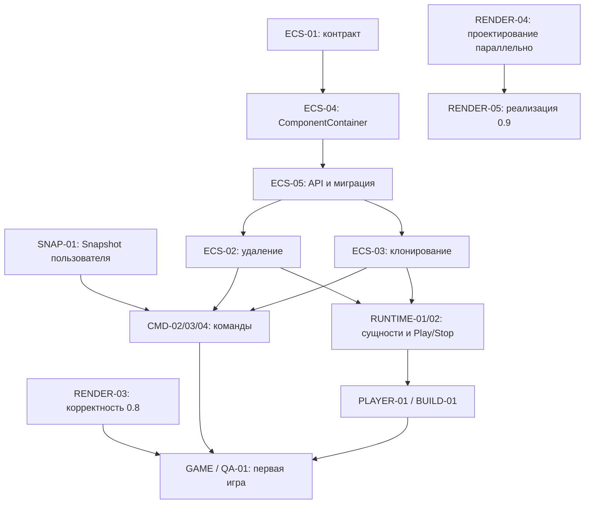

# Общий план robot2D

Обновлено: 2026-10-15. Это точка входа для всех направлений и чатов проекта:
Core, ECS, Render, Editor, runtime/player, пример игры и инструменты выпуска.
Релизные критерии — [release-roadmap.md](release-roadmap.md). Оперативные статусы,
выбранные ведущие и результаты находятся в GitHub Issues и
[Projects](https://github.com/users/Enziferum/projects/5).

## Где находится информация

| Информация | Источник |
|---|---|
| Общие направления, зависимости и синхронизация чатов | Этот документ |
| Цели 0.8.0 / 0.9.0 / 1.0.0 и реестр релизных задач | [release-roadmap.md](release-roadmap.md) |
| ID и номер Issue; определения меток | [.github/tasks.json](../.github/tasks.json), [.github/task-labels.json](../.github/task-labels.json) |
| Текущий Status, ведущий, границы шага, PR и приёмка | Соответствующая Issue и Projects |
| История работы над редактором и прежних проверок | [editor-roadmap.md](editor-roadmap.md) |
| Нумерация, ветки, коммиты и выбор ведущего | [project-workflow.md](project-workflow.md) |

Не заводить отдельный конкурирующий roadmap для нового чата. Новый объём
сначала связывается с этим планом и зарегистрированным Issue. Milestone задаёт
целевой релиз результата; работа и проектирование могут идти раньше и параллельно.
Новая задача или статус Ready сами по себе не разрешают рефакторинг всего направления.

## Общая база и ветки

Основная интеграционная ветка — `dev`. `october2026_dev` слита в неё через
PR #43 (e54408f); новые задачи идут от актуального dev в `codex/<task-id>-<описание>`
и возвращаются в dev через PR. Ближе к стабилизации от dev создаётся
`release/0.8.0`, выпуск фиксируется тегом `v0.8.0`; исправления возвращаются в dev.
Большой несовместимый объём 0.9 интегрируется после отделения релиза 0.8 либо
отдельными согласованными совместимыми шагами. Правила —
[project-workflow.md](project-workflow.md), версия — [versioning.md](versioning.md).

## Направления проекта

| Направление | 0.8.0 | 0.9.0 | 1.0.0 |
|---|---|---|---|
| Core / ECS | Контракты и необходимые изменения удаления, клонирования, ComponentContainer и API для команд/runtime | Следующие изменения только по отдельно согласованной потребности | Стабильность поддерживаемого API и проверенные миграции |
| Core / Render | Опубликованные RENDER-01/02; RENDER-03 — корректность порядка, камеры и resize для игры | RENDER-04 — контракт; RENDER-05 — основная реализация нового 2D-рендера | Надёжность поддерживаемых сценариев и поставки |
| Editor | Команды/Undo, сохранение, минимальные ресурсы, prefab, анимация | Разделение ответственности, удобство UI/viewport, развитие анимационных инструментов | Восстановление, документация и качество основного цикла |
| Runtime / Player | C#, создание/удаление объектов, физика, ввод, Play/Stop, ранний standalone и Build | Переходы сцен, звук и игровые UI-компоненты | Совместимость, полный цикл и проверенная поставка |
| Пример игры | Играбельная арена и её сборка без dev-окружения | Расширение примера для проверки новых возможностей | Воспроизводимый пример и инструкция для нового пользователя |
| Инструменты | Действующие hooks/CI/версии и воспроизводимый Build | Проверки вместе с изменением поведения | Installer, GitHub Release, проверка новой версии и RC |

3D сохраняется в существующем рабочем объёме. Новый 3D renderer пока не имеет
согласованных объёма и версии; он не включается автоматически в RENDER-05.

## Core / ECS: замысел пользователя

Пользователь назвал четыре направления: удаление, клонирование, API и
ComponentContainer. На этом этапе оформлены задачи и зависимости; новый backend
хранения, archetypes/sparse-set, queries и многопоточность не выбраны и не обещаны.

| Задача | Результат | Цель |
|---|---|---|
| [ECS-01 #100](https://github.com/Enziferum/robot2D/issues/100) | Согласовать контракты, объём и первый шаг | 0.8.0, можно начинать обсуждение |
| [ECS-04 #101](https://github.com/Enziferum/robot2D/issues/101) | Владение и операции ComponentContainer, copy/move и доступ | 0.8.0, после ECS-01 |
| [ECS-05 #102](https://github.com/Enziferum/robot2D/issues/102) | API ECS и миграция потребителей | 0.8.0, после ECS-01/04 |
| [ECS-02 #103](https://github.com/Enziferum/robot2D/issues/103) | Согласованное удаление и восстановление, очереди и системы | 0.8.0, после ECS-01/04/05 |
| [ECS-03 #104](https://github.com/Enziferum/robot2D/issues/104) | Clone/Duplicate, идентификаторы и независимость миров | 0.8.0, после ECS-01/04/05 |

В 0.8 нужен согласованный объём, обеспечивающий корректность команд и runtime.
Его размер уточняется в ECS-01; соседние оптимизации не становятся обязательным
условием первой игры. Ведущий и формат помощи выбираются до реализации.
Пользователь может сам вести сложные задачи Core; ассистент не забирает их автоматически.

При согласовании ECS-01 отдельно разобрать:

- Core EntityID и editor UUID — разные идентичности; определить их соответствие при копировании.
- Когда Entity считается доступной системам и когда её старые ссылки становятся недействительными.
- Можно ли менять состав компонентов и удалять сущности во время обхода/callback; когда применяются очереди.
- Кому принадлежат удалённые данные: сейчас EntityManager копирует компоненты в delete buffer;
  границу с пользовательским Snapshot нужно согласовать до изменения этого механизма.
- Какие компоненты копируются, какие ресурсы разделяются и как обрабатывается невозможность клонирования.
- Как новый API сохраняет независимость Core от popup, выделения, истории и остальных сценариев Editor.

По чтению кода требуют проверки семантика Entity::operator bool/destroyed,
реализации copy/move контейнера, clone с пропусками ID и duplicate без систем.
Это точки для разбора и регрессий; новые тесты или исправления в рамках планирования
не выполнялись. Изменение backend хранения без обсуждения не согласовано.

## Core / Render: параллельная работа

Распределение подтверждено пользователем 2026-10-15:

- [RENDER-03 #82](https://github.com/Enziferum/robot2D/issues/82) остаётся в 0.8.0:
  смешанный порядок sprite/text/VertexArray, прозрачность/HUD, камера и resize.
- [RENDER-04 #98](https://github.com/Enziferum/robot2D/issues/98) относится к результату 0.9.0,
  но проектирование начинается сейчас параллельно 0.8: единая очередь, z-order,
  target/проходы, камера/материал команды, shader/blend и жизнь ресурсов.
- [RENDER-05 #99](https://github.com/Enziferum/robot2D/issues/99) — основная реализация
  согласованного 2D-контракта и адаптация Core/Editor/player в 0.9.0.

Если корректность 0.8 требует элемента нового устройства, выделить минимальный
согласованный шаг в RENDER-03, связать его с RENDER-04 и проверить обе ветки работы.
Не откладывать блокирующий дефект игры до окончания полного рефакторинга.
Предыдущие результаты и ограничения — [render-batching.md](render-batching.md).

## Зависимости Core и потребителей

Это зависимости интеграции результатов, а не требование ждать окончания всех
задач для обсуждения и прототипов. Контракты ECS-01 и SNAP-01 согласуются вместе.
Менять код пользовательского Snapshot/CancellationToken без запроса нельзя.

## Как чаты синхронизируют работу

1. В начале прочитать AGENTS.md, этот документ и релизный план; проверить локальный
   `git status`, соответствующую Issue, ветку/HEAD и актуальное состояние GitHub.
2. Проверить существующие Issues и реестр до создания нового ID. Указать компонент
   метками (`area:core`, `area:render`, `area:editor`, `area:tooling` и др.), milestone,
   родителя, зависимости, ведущего и согласованный первый шаг.
3. Перед изменением общего API перечислить затронутые потребители и связанные задачи.
   Зафиксировать договорённость и последовательность интеграции в Issues/документации.
   Не начинать несовместимые изменения тех же контрактов молча в разных чатах.
4. В активной Issue сохранять границы файлов/модулей, ветку и commit/PR, текущее
   состояние, блокеры и следующий шаг. В разных checkout нельзя полагаться на
   незакоммиченные файлы другого чата; изменения общего плана публикуются в Git.
5. После шага записать фактические проверки и ограничения, обновить Status через gh
   и связанные задачи. Не объявлять задачу другого направления Done из-за merge
   соседнего PR и не подменять реальный UI/игровую приёмку CI.
6. В конце оставить краткую передачу контекста: что сделано, что осталось, какие
   контракты изменились и с какого commit продолжать. При смене объёма обновить
   общий и релизный планы; исторические результаты не переписывать как новые.

Канонические статусы — в Issues/Projects, а не в таблице этого документа.
Если общая выдача Projects пропускает элемент, проверить прямую связь Issue с
проектом и Status: одно успешное выполнение команды добавления не доказывает результат.

## Передача контекста: синхронизация 2026-10-15

Продолжение ASSET-02 после PR #105: проверен `dev` @ `9f131c5`, от него создана
и связана с #73 ветка `codex/asset-02-resource-identity`. Исправляются коллизии
имён изображений/шрифтов/спрайтшитов в кэшах разных каталогов и проектов;
контракт — [project-assets.md](project-assets.md). Критерии Build/standalone и
UI-приёмка ещё открыты. Из пяти порученных задач только PHYS-01 напрямую зависит
от RUNTIME-01, причём это зависимость полной интеграции, а не блокировка
независимых исправлений физики. ANIM-01/PREFAB-01/RENDER-03 ждать её не должны.

Пользователь поручил ассистенту реализацию ASSET-02, ANIM-01, PREFAB-01,
PHYS-01 и RENDER-03 в одном чате. Выбран порядок ASSET-02 → ANIM-01 →
PREFAB-01 → RENDER-03 → PHYS-01; интеграция PHYS-01 зависит от RUNTIME-01.
Snapshot/CancellationToken и задачи ECS этим поручением не переданы.
Начат ASSET-02 в `codex/asset-02-portable-resources` от `2489134`;
первый файловый контракт и ограничения — [project-assets.md](project-assets.md).
Первый шаг зафиксирован коммитом f5cea51 и перенесён на новую базу dev после
слияния PR #43. Интеграция этого шага проводится через отдельный PR в dev;
Issue #73 остаётся открытой: нужны идентичность одноимённых ресурсов, UI-приёмка
и интеграция с PLAYER-01/BUILD-01. Результаты — в editor-roadmap.md и Issue.

Созданы семь задач RENDER-04/05 и ECS-01/02/03/04/05. Через gh повторно проверены
их milestones, метки, описания, родительские связи и прямое членство/статусы Projects.
Обновлены связи в 11 существующих задачах, включая релизные трекеры, CMD/Snapshot,
runtime и RENDER-01/02/03. Проверены реестр ID/номеров, метки, Markdown-ссылки,
dry-run sync_task_labels.ps1 и отсутствие циклов в объединённых зависимостях.
Общая карта добавлена в README и AGENTS.md; исходники и поведение не менялись,
сборка и native-тесты для этих документационных изменений не запускались.
Следующие обсуждения: ECS-01 вместе с SNAP-01; независимо — контракт RENDER-04.
